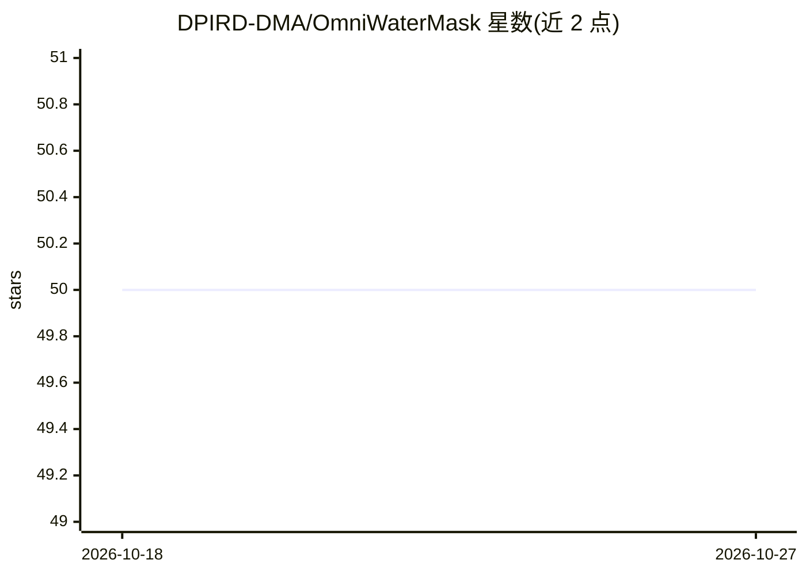

# DPIRD-DMA/OmniWaterMask

⭐ 50 · Python · MIT · 推送 2026-10-12 · [GitHub](https://github.com/DPIRD-DMA/OmniWaterMask) · 组织维护

**遥感与航拍影像的高精度水体分割 Python 库**

面向遥感开发者的水体分割库：将传感器无关的深度学习分割模型与 NDWI、Overture/OSM 矢量数据结合，在 0.2m–50m 分辨率影像中提取水体掩膜。输入仅需 Red/Green/Blue/NIR 波段的 GeoTIFF，make_water_mask 输出逐像元水/非水 GeoTIFF。已验证适配 Sentinel-2、Landsat 8、PlanetScope、Maxar、NAIP。限制：运行需联网下载矢量数据；矢量来源默认 Overture Maps，发布不固定导致旧运行不可复现；模型版本 2 处于 beta，默认安装仍为版本 1（fastai 模型，需 legacy extra）。

## 筛选速览

| 维度 | 判定 | 备注 |
|---|---|---|
| AI 角色 | `ai-native` | 本体是模型或模型工具 |
| 许可风险 | `permissive` | MIT |
| 部署形态 | `library` | 以包/库形式分发 |
| 模型依赖 | — | README 未给出锁定关系 |
| 硬件要求 | — | 无带数字的原话,不猜 |
| 安装摩擦 | `medium` | 含编译或系统依赖之一 |
| 成熟度 | `idea` | |

## 能力要点

- 深度学习模型 + NDWI + 矢量数据组合的水体提取
- 支持 0.2m–50m 分辨率与多种传感器（Sentinel-2/Landsat 8/PlanetScope/Maxar/NAIP）
- 仅需 Red/Green/Blue/NIR 四个波段
- 支持 NVIDIA GPU / Apple Silicon / CPU 推理设备与自动精度选择

## 适用场景

- 对卫星或航拍影像批量生成水体/非水分类 GeoTIFF
- 多云 Sentinel-2 场景下配合云掩膜做水体提取
- 结合自有水体制图或负样本矢量（建筑/道路）提升检测精度

## 场景标签

`目标检测` · 领域:感知与多模态

## 证据(README 行号)

> L8: OmniWaterMask is a Python library for high accuracy water segmentation in high to moderate resolution satellite imag
> L38: OmniWaterMask combines a sensor agnostic deep learning segmentation model with NDWI and vector data to find water i

## 星数曲线

2026-10-18 50 → 2026-10-27 50（+0）

---
*卡片 v1 · prompt 1.4 · 生成 2026-10-24 · 置信度 high · 依据 README sha `1e83959fabd5` · [字段定义](../../DATASET.md)*
