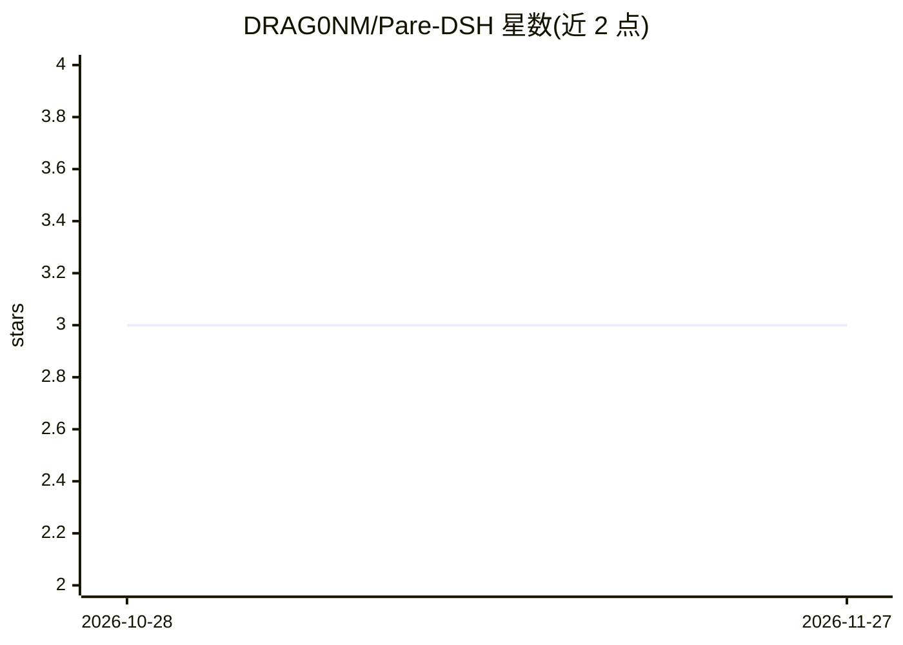

# DRAG0NM/Pare-DSH

⭐ 3 · JavaScript · MIT · 推送 2026-10-25 · [GitHub](https://github.com/DRAG0NM/Pare-DSH) · [官网](https://www.npmjs.com/package/@drag0nm/pare-dsh) · 个人维护 · 中文 README

**面向 DSH 用户的 AI 磁盘调查清理插件**

DeepSeek Harness（DSH）插件：将 Pare 磁盘调查核心接入 DSH 会话。插件启动长驻的 `pare serve` 进程并注册只读扫描与调查工具（扫描大文件、重复文件、已装程序、进程等），清理操作需经 DSH 自带审批提示逐次批准，文件进入可逆隔离区而非直接删除。核心二进制按版本锁定并做 SHA-256 校验，首次启动需联网下载。仅支持 Windows，依赖 Node.js 22.19+ 与 DSH 0.2.1-rc.2。

## 筛选速览

| 维度 | 判定 | 备注 |
|---|---|---|
| AI 角色 | `ai-native` | 本体是模型或模型工具 |
| 许可风险 | `permissive` | MIT |
| 部署形态 | `desktop` | 安装包/桌面程序 |
| 模型依赖 | — | README 未给出锁定关系 |
| 硬件要求 | — | 无带数字的原话,不猜 |
| 安装摩擦 | `low` | 无编译、无系统依赖或容器化 |
| 成熟度 | — | 结构信号不足 |

## 能力要点

- 只读调查工具与需审批的清理/撤销/永久删除工具分离
- 清理经 DSH 自带审批门控，文件先入可逆隔离区
- 核心二进制按版本锁定并在启动时校验 SHA-256
- 敏感文件每次读取都需单独批准

## 适用场景

- 在 DSH 会话里用自然语言调查磁盘空间浪费
- 审批后执行可撤销的文件清理
- 误清理后从隔离区批量恢复文件

## 场景标签

`AI 助手` · 领域:对话与助手

## 证据(README 行号)

> L11: Pare-DSH brings Pare's AI disk investigation into DeepSeek Harness (DSH). The DSH agent investigates this machine's
> L38: |`pare_scan`|Read-only scan of a drive or folder; keeps the index in the core process|No|

## 星数曲线

2026-10-28 3 → 2026-11-27 3（+0）

---
*卡片 v1 · prompt 1.4 · 生成 2026-11-22 · 置信度 high · 依据 README sha `c3c7ab06b6f9` · [字段定义](../../DATASET.md)*
