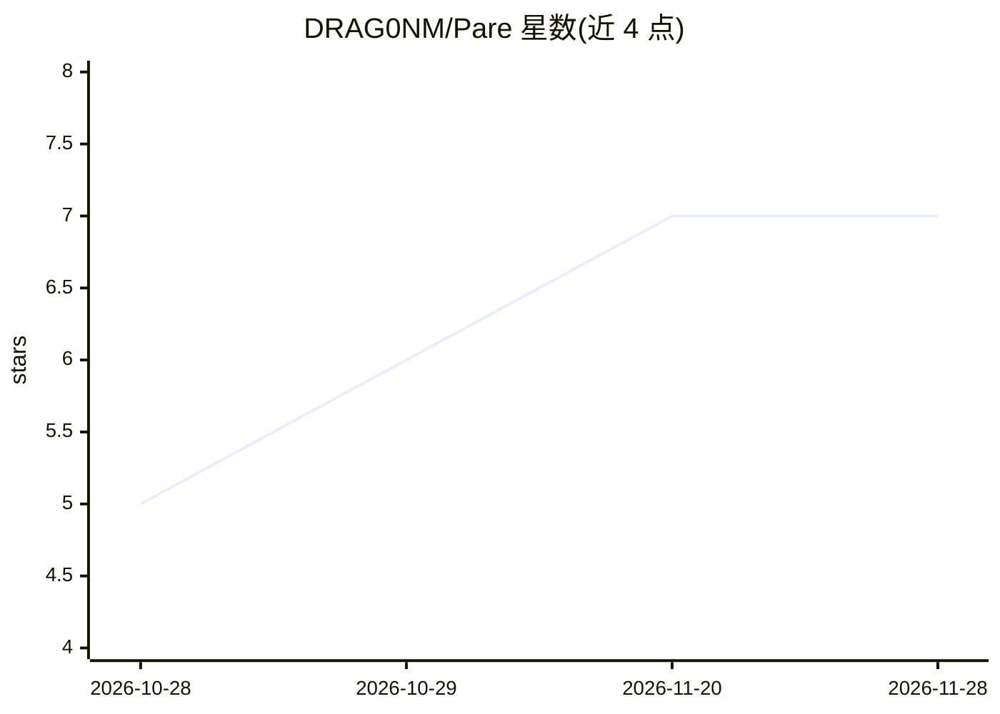

# DRAG0NM/Pare

⭐ 7 · Go · MIT · 推送 2026-10-25 · [GitHub](https://github.com/DRAG0NM/Pare) · 个人维护 · 中文 README

**Windows 磁盘清理工具：AI 调查单机特有的空间浪费**

面向 Windows 的磁盘调查与清理桌面应用：并行扫描建立文件索引，随后由接入的模型以只读工具（文件头、已装程序、进程、WSL/驱动/组件存储等诊断）调查机器特有的空间浪费，输出带证据的成因、复发判断与处置选项；所有改动需用户确认，文件清理默认进入可恢复的隔离区。提供便携版 zip（免安装）与 Go 源码构建路径，界面支持六种语言。清理模板之外的命令不可由工具撤销。

## 筛选速览

| 维度 | 判定 | 备注 |
|---|---|---|
| AI 角色 | `ai-enhanced` | 去掉 AI 部分产品仍成立 |
| 许可风险 | `permissive` | MIT |
| 部署形态 | `desktop` | 安装包/桌面程序 |
| 模型依赖 | locked-api |  |
| 硬件要求 | — | 无带数字的原话,不猜 |
| 安装摩擦 | `low` | 无编译、无系统依赖或容器化 |
| 成熟度 | — | 结构信号不足 |

## 能力要点

- 模型以只读工具调查扫描索引，每条发现附带证据
- 清理默认进入同卷隔离区，可分批恢复，永久删除为显式步骤
- 支持 WSL 磁盘迁移、journald 上限、npm/pip 缓存、DISM 清理等动作模板
- 执行前后实测可用空间，隔离占用单独报告

## 适用场景

- 排查单台机器特有的磁盘空间占用来源
- 清理 WSL 虚拟磁盘、npm/pip 缓存等常见增长点
- 希望在清理前逐条审查并将文件保留为可恢复状态

## 场景标签

 · 领域:系统工具/磁盘管理

## 证据(README 行号)

> L17: **Pare sends an AI investigator after that kind of waste.** It reads the scan, opens the files it needs, cross-chec
> L44: 3. Pick a drive. When you open the clean stage for the first time, Pare asks for an API key from an OpenAI-compatib

## 星数曲线

2026-10-28 5 → 2026-11-28 7（+2）

---
*卡片 v1 · prompt 1.4 · 生成 2026-11-20 · 置信度 high · 依据 README sha `afa03a3f9767` · [字段定义](../../DATASET.md)*
