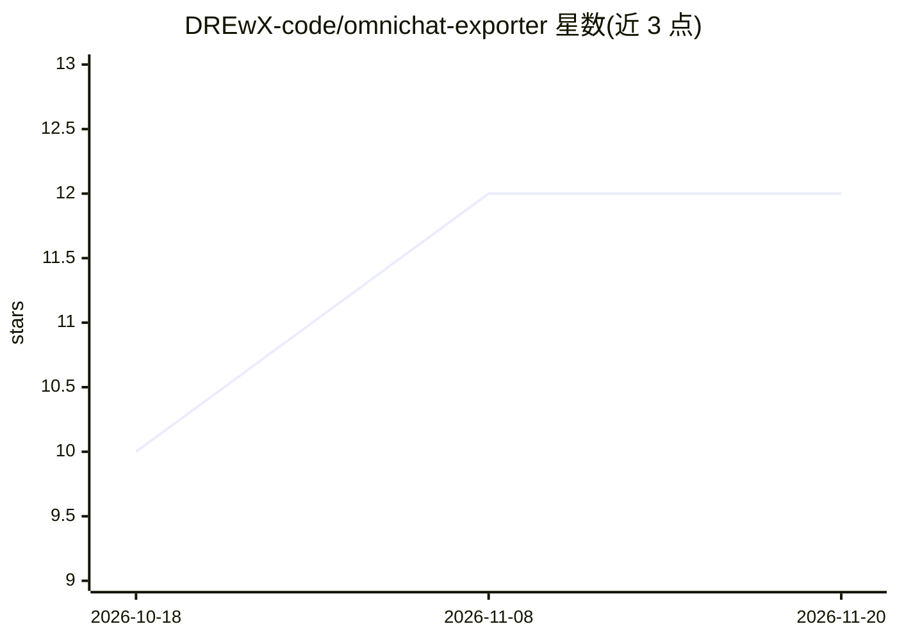

# DREwX-code/omnichat-exporter

⭐ 12 · JavaScript · Apache-2.0 · 推送 2026-11-03 · [GitHub](https://github.com/DREwX-code/omnichat-exporter) · [官网](https://greasyfork.org/scripts/567743-omnichat-exporter-export-any-ai-chat-instantly) · 个人维护

**在主流 AI 聊天平台内导出会话为 TXT/PDF/JSON/Markdown 的油猴脚本**

一个浏览器用户脚本（需 Tampermonkey/Violentmonkey），在 ChatGPT、Gemini、Claude、Grok、DeepSeek 页面内注入导出控件，支持整段会话或单条消息导出为 TXT、Markdown、JSON、PDF。PDF 由 pdfmake 在浏览器端生成，包含语言/文字检测、按文字系统动态加载 Noto 字体、KaTeX/MathML 公式、代码块高亮与 AI 图片嵌入。全部导出在本地完成，不向外部服务发送会话数据。限制：emoji 为单色渲染，复杂数学表达式可能与原平台显示不完全一致。

## 筛选速览

| 维度 | 判定 | 备注 |
|---|---|---|
| AI 角色 | `ai-ecosystem` | LLM/agent 周边工具 |
| 许可风险 | `permissive` | Apache-2.0 |
| 部署形态 | `None` |  |
| 模型依赖 | — | README 未给出锁定关系 |
| 硬件要求 | — | 无带数字的原话,不猜 |
| 安装摩擦 | `low` | 无编译、无系统依赖或容器化 |
| 成熟度 | — | 结构信号不足 |

## 能力要点

- 四种导出格式：TXT / Markdown / JSON / PDF
- PDF 生成含语言检测与按脚本动态加载多语言字体
- JSON 导出保留消息角色、顺序与 HTML 内容，便于自动化处理
- 导出全部在浏览器本地完成，不调用外部 API

## 适用场景

- 备份我在 ChatGPT/Claude 等平台上的对话记录
- 把 AI 对话整理成 Markdown 笔记或文档复用
- 用 JSON 格式把会话数据接入脚本和分析流水线

## 场景标签

 · 领域:工具/浏览器扩展

## 证据(README 行号)

> L23: OmniChat Exporter allows you to export conversations from **ChatGPT, Gemini, Claude, Grok, and DeepSeek** in **TXT,
> L154: 1. Install a userscript manager such as **Tampermonkey** or **Violentmonkey**.
> L35: Everything runs locally.

## 星数曲线

2026-10-18 10 → 2026-11-20 12（+2）

---
*卡片 v1 · prompt 1.4 · 生成 2026-11-18 · 置信度 high · 依据 README sha `ed106b82248c` · [字段定义](../../DATASET.md)*
