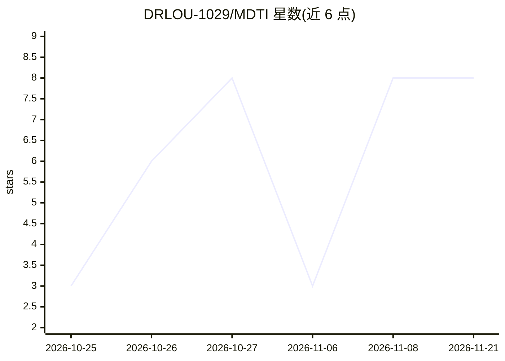

# DRLOU-1029/MDTI

⭐ 8 · Python · 推送 2026-10-24 · [GitHub](https://github.com/DRLOU-1029/MDTI) · [官网](http://49.234.44.131:1145/) · 个人维护 · 中文 README

**基于麦当劳 MCP 的点餐人格测试与点餐 agent**

MDTI 是一个运行在麦当劳官方 MCP Server 上的 Agent Skill：12 道二选一题经确定性脚本映射到四轴十六型人格，人格作为配置改变 agent 点餐时的候选池、排序键与说话方式。价格来自 calculate-price 工具实算，控型额外核算热量，方案带真实门店、价格与可用券。支持演示模式（脱敏快照、0 次 MCP 调用），无第三方依赖，Python 3.9+ 即可运行。README 声明为娱乐向测试，不构成营养建议。

## 筛选速览

| 维度 | 判定 | 备注 |
|---|---|---|
| AI 角色 | `ai-native` | 本体是模型或模型工具 |
| 许可风险 | `none` | — |
| 部署形态 | `None` |  |
| 模型依赖 | — | README 未给出锁定关系 |
| 硬件要求 | — | 无带数字的原话,不猜 |
| 安装摩擦 | `low` | 无编译、无系统依赖或容器化 |
| 成熟度 | — | 结构信号不足 |

## 能力要点

- 12 题确定性脚本得出四轴十六型，同组答案结果一致
- 接入麦当劳官方 MCP（mcp.mcd.cn），价格经 calculate-price 实算
- 演示模式无需 Token，离线走完流程不产生真实订单
- 提供 CLI 评分脚本与网页调试台

## 适用场景

- 测一下自己的点餐人格并生成带预算的套餐方案
- 让 agent 替自己做每日点餐决定
- 一群人点餐时按人均和份量出团餐方案
- 无 Token 时离线体验完整流程

## 场景标签

`AI 助手` · 领域:对话与助手

## 证据(README 行号)

> L6: MDTI（McDonald's Type Indicator）是一个跑在麦当劳 MCP 上的 Agent Skill：12 道二选一题 → **四轴十六型** → 四个策略开关直接改变 agent 点餐时的候选池、排序键和说话方式。
> L13: 2. **类型是配置，不是装饰。** 四个轴各自对应一组 MCP tool 调用：算型必须走券 + 实算价，感型只给结论；控型必须核算热量，纵型不看热量。
> L16: 它解决的不是「吃什么」，是**「每次都要重新做二十个决定」**。测一次，以后这类决定交给一个有你性格的 agent。

## 星数曲线

2026-10-25 3 → 2026-11-21 8（+5）

---
*卡片 v1 · prompt 1.4 · 生成 2026-11-20 · 置信度 high · 依据 README sha `4d9cbe88c4a5` · [字段定义](../../DATASET.md)*
