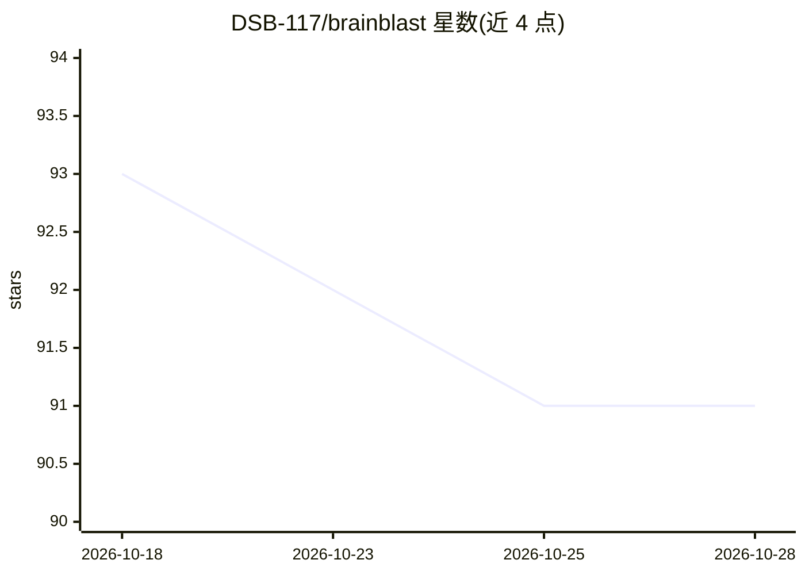

# DSB-117/brainblast

⭐ 91 · TypeScript · MIT · 推送 2026-07-17 · [GitHub](https://github.com/DSB-117/brainblast) · [官网](https://www.npmjs.com/package/brainblast) · 个人维护

**为 AI 编码 agent 做外部 API/SDK 前置研究与 CI 静态审计的工具**

面向使用 AI 编码 agent 的开发者的研究加审计工具：/brainblast 技能读取需求文档，自动识别外部组件（API、SDK、认证、支付、链），浏览官方文档与包注册表生成带来源 URL 的结构化报告与 report.json；npm CLI 在 CI 中离线静态扫描代码，检测 Stripe webhook、Privy/JWT、Solana fee-share 等十八类集成陷阱，可按严重级别 gate 构建。另提供 Solana 交易防火墙、IDL 规则生成、链上监控等子命令。报告缓存按 name@version 增量复用。

## 筛选速览

| 维度 | 判定 | 备注 |
|---|---|---|
| AI 角色 | `ai-ecosystem` | LLM/agent 周边工具 |
| 许可风险 | `permissive` | MIT |
| 部署形态 | `library` | 以包/库形式分发 |
| 模型依赖 | — | README 未给出锁定关系 |
| 硬件要求 | — | 无带数字的原话,不猜 |
| 安装摩擦 | `low` | 无编译、无系统依赖或容器化 |
| 成熟度 | — | 结构信号不足 |

## 能力要点

- 研究技能自动识别需求中的外部组件并浏览实时文档生成结构化报告
- npm CLI 离线静态扫描十八类内置集成陷阱，CI 中按严重级别 gate 构建
- 可插拔验证 oracle（静态检查/编译器/沙箱执行）
- Solana 全生命周期工具：交易防火墙、程序信任评分、链上监控

## 适用场景

- AI agent 写代码前研究外部 API/SDK 的版本与配置约束
- CI 中拦截静默零收入配置、JWT 验证缺失等集成错误
- 审计 Solana 程序部署与代币交易安全

## 场景标签

`网络安全` · 领域:学习与行业

## 证据(README 行号)

> L15: Brainblast runs first. It reads your requirements, identifies every external component, browses official docs and p
> L19: **Two entry points, one product.** Brainblast *predicts* the failure before any code exists — the
> L59: - Published to npm as `brainblast@1.0.0` with SLSA provenance attestation — `npx brainblast .` runs it with no inst

## 星数曲线

2026-10-18 93 → 2026-10-28 91（-2）

---
*卡片 v1 · prompt 1.4 · 生成 2026-10-23 · 置信度 high · 依据 README sha `31dffe89261c` · [字段定义](../../DATASET.md)*
