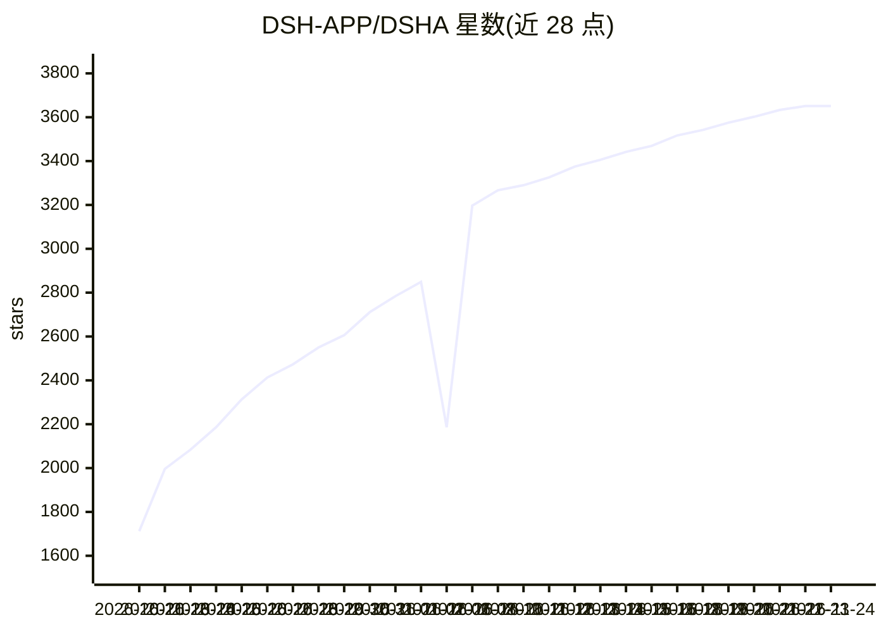

# DSH-APP/DSHA

⭐ 3,674 · Java · MIT · 推送 2026-11-14 · [GitHub](https://github.com/DSH-APP/DSHA) · 组织维护 · 中文 README

**免 ROOT 免 Termux 在安卓手机上运行 DeepSeek Harness 的启动器**

把 DeepSeek 官方 agent harness（@deepseek-ai/dsh）打包进单个 APK 的安卓启动器：内置 Ubuntu 24.04 arm64 离线 rootfs 与 Node.js 24/pnpm 运行时，默认 proot、可选 proroot 双运行时。首次启动解压校验环境后，经 Web UI 配置提供商、模型与 API Key。提供无障碍/ADB/Shizuku/Root 多通道设备操作、真 PTY 终端、插件管理、备份迁移与组件级自检修复。仅支持 Android 11+ 与 arm64-v8a，APK 约 302 MiB；bash 的 bubblewrap 沙箱在安卓上不可用，约束依赖 dsh 权限档位。

## 筛选速览

| 维度 | 判定 | 备注 |
|---|---|---|
| AI 角色 | `ai-ecosystem` | LLM/agent 周边工具 |
| 许可风险 | `permissive` | MIT |
| 部署形态 | `None` |  |
| 模型依赖 | — | README 未给出锁定关系 |
| 硬件要求 | — | 无带数字的原话,不猜 |
| 安装摩擦 | `high` | 编译与系统依赖俱全 |
| 成熟度 | — | 结构信号不足 |

## 能力要点

- 内置离线 Ubuntu rootfs，安装 APK 即用，无需 Termux/ROOT/命令行
- 无障碍 + ADB 免 Shizuku 直连 + 独立虚拟屏，agent 可读屏、点按、执行设备命令
- proot/proroot 双运行时，插件管理、六步装机流水线与按需修复
- 无密码 .tar.gz 备份导出、自动备份计划与换机恢复

## 适用场景

- 在手机上以移动 UI 运行 DeepSeek agent harness
- 让 agent 直接操作手机（读屏、点按、自动化）
- 电脑浏览器经局域网访问手机上的 dsh
- 无网络环境下部署完整 Ubuntu 工具链

## 场景标签

`编码 Agent` `GUI 自动化` · 领域:效率与自动化

## 证据(README 行号)

> L38: **DSHA 把这些全部封在一个 APK 里。** 首次启动解压并校验内置的离线环境，完成后进入主页、Web 在后台启动；打开 Web UI 再配置提供商、模型与 API Key。不需要 Termux、ROOT，也不需要敲一行命令
> L103: |proroot / proot 双运行时|默认稳定的 proot；可在「配置」选择 proroot，实际兼容结果依机型|
> L216: ## 与同类方案的关系

## 星数曲线

2026-10-21 1,712 → 2026-11-24 3,651（+1,939）

---
*卡片 v1 · prompt 1.4 · 生成 2026-11-23 · 置信度 high · 依据 README sha `79be6da3d455` · [字段定义](../../DATASET.md)*
