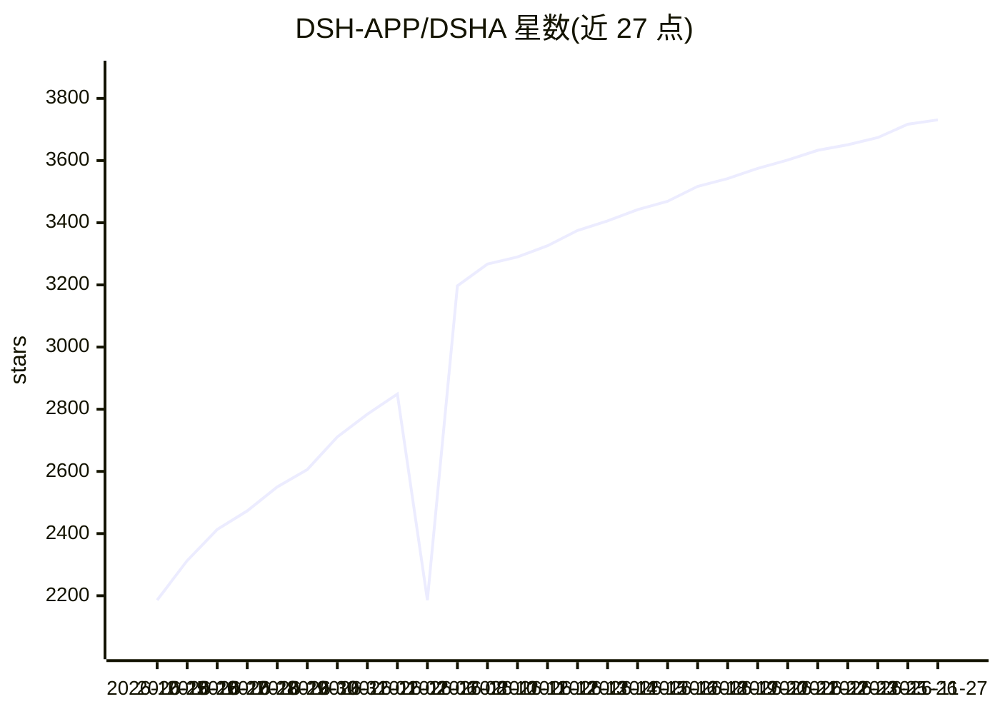

# DSH-APP/DSHA

⭐ 3,731 · Java · MIT · 推送 2026-11-26 · [GitHub](https://github.com/DSH-APP/DSHA) · 组织维护 · 中文 README

**在 Android 手机免 ROOT 运行 DeepSeek Harness 的启动器**

将 DeepSeek 官方 agent harness（@deepseek-ai/dsh）打包为单个 APK 的 Android 启动器：内置 Ubuntu 24.04 arm64 离线 rootfs、Node.js 24 与 pnpm，首启自动解包校验环境，通过 Web UI 配置 provider、模型与 API key。默认 proot 运行时，可选 proroot。提供无障碍服务控制屏幕、ADB 直连、独立虚拟屏等设备能力供 agent 调用，并内置备份导出、自检修复与看门狗。要求 Android 11+ / arm64-v8a，APK 约 302 MiB。

## 筛选速览

| 维度 | 判定 | 备注 |
|---|---|---|
| AI 角色 | `ai-ecosystem` | LLM/agent 周边工具 |
| 许可风险 | `permissive` | MIT |
| 部署形态 | `None` |  |
| 模型依赖 | locked-api |  |
| 硬件要求 | — | 无带数字的原话,不猜 |
| 安装摩擦 | `medium` | 含编译或系统依赖之一 |
| 成熟度 | — | 结构信号不足 |

## 能力要点

- APK 内置离线 Ubuntu 24.04 rootfs，安装即用，无需 Termux 或 ROOT
- 六步安装管线（解包→工具→Node→pnpm→dsh→补丁），失败步骤单独重试
- 无障碍服务+ADB+独立虚拟屏：agent 可读取屏幕、点击、安装应用、执行自动化
- v5 备份导出为免密 .tar.gz，支持定时自动备份与跨机迁移

## 适用场景

- 在手机上以本地环境运行 deepseek-harness 编码 agent
- 让 agent 通过无障碍服务直接操作手机应用
- 旧手机迁移：导出会话、插件与设置并在新机恢复

## 场景标签

`编码 Agent` `GUI 自动化` · 领域:效率与自动化

## 证据(README 行号)

> L54: DeepSeek Harness (`@deepseek-ai/dsh`) is DeepSeek's official agent harness, written for glibc Linux. Running it dir
> L56: **DSHA packs all of that into one APK.** On first launch it unpacks and verifies a bundled offline environment, the

## 星数曲线

2026-10-25 2,186 → 2026-11-27 3,731（+1,545）

---
*卡片 v1 · prompt 1.4 · 生成 2026-11-27 · 置信度 high · 依据 README sha `25a362c142cb` · [字段定义](../../DATASET.md)*
