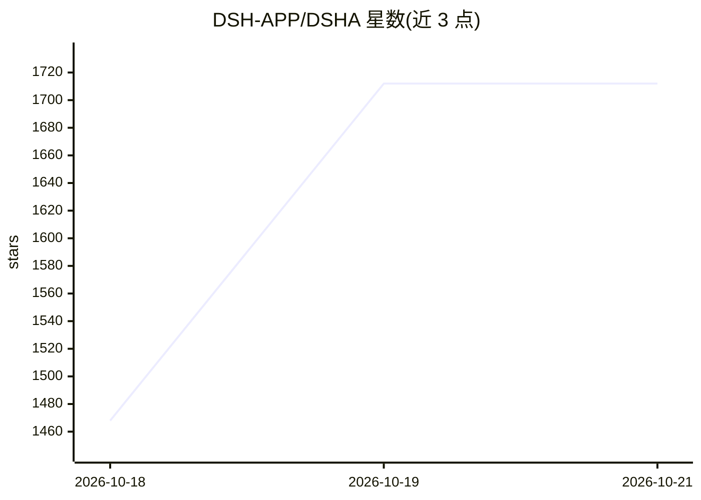

# DSH-APP/DSHA

⭐ — · [GitHub]() · 组织维护 · 中文 README

**安卓上运行 DeepSeek Harness 的免 ROOT 启动器**

把 DeepSeek 官方 agent harness（@deepseek-ai/dsh，类 Claude Code）封装进一个 APK：内置完整 Ubuntu 24.04 arm64 rootfs，通过 bxroot/proot 双运行时在免 ROOT、免 Termux 条件下运行 glibc 环境，装 APK、填 API key 即可启动 Web UI。面向想在手机上跑编码 agent 的安卓用户。附带 PTY 终端、插件市场、自动备份，以及经无障碍/ADB/Shizuku 通道让 agent 操作本机手机的设备能力（token 门控、命令白名单）。限制：仅 arm64-v8a，Standard 需 Android 11+（Low 6+），APK 体积 273–345 MiB，bash 沙箱隔离不可用。

## 筛选速览

| 维度 | 判定 | 备注 |
|---|---|---|
| AI 角色 | `ai-native` | 本体是模型或模型工具 |
| 许可风险 | `permissive` | — |
| 部署形态 | `None` |  |
| 模型依赖 | locked-api |  |
| 硬件要求 | — | 无带数字的原话,不猜 |
| 安装摩擦 | `high` | 编译与系统依赖俱全 |
| 成熟度 | — | 结构信号不足 |

## 能力要点

- 内置离线 Ubuntu 24.04 rootfs，bxroot/proot 双运行时，免 ROOT 免 Termux
- agent 可经无障碍/ADB 无线直连/虚拟屏操作本机手机，命令白名单守门
- 真 PTY 终端（多标签）、插件市场、自动备份与导出 .tar.gz
- AI 输出流式悬浮条，支持局域网访问与画中画

## 适用场景

- 在安卓手机上直接使用 DeepSeek 官方 coding agent，不装 Termux
- 让 agent 通过无障碍/ADB 读写屏幕、点按操作这台手机
- 用手机终端跑 vim/htop/tmux 与上游插件生态

## 场景标签

`编码 Agent` `GUI 自动化` · 领域:效率与自动化

## 证据(README 行号)

> L30: DeepSeek Harness（`@deepseek-ai/dsh`）是 DeepSeek 官方的 agent harness，类 Claude Code。
> L34: **DSHA 把这些全部封在一个 APK 里。** 装 APK、填 API key（或跳过）、点启动 —— 不需要 Termux、
> L76: 3. 「配置」页填 DeepSeek API key →「启动」页点启动 → 自动打开 Web UI

## 星数曲线

2026-10-18 1,468 → 2026-10-21 1,712（+244）

---
*卡片 v1 · prompt 1.4 · 生成 2026-10-21 · 置信度 high · 依据 README sha `4d6a3720dbec` · [字段定义](../../DATASET.md)*
