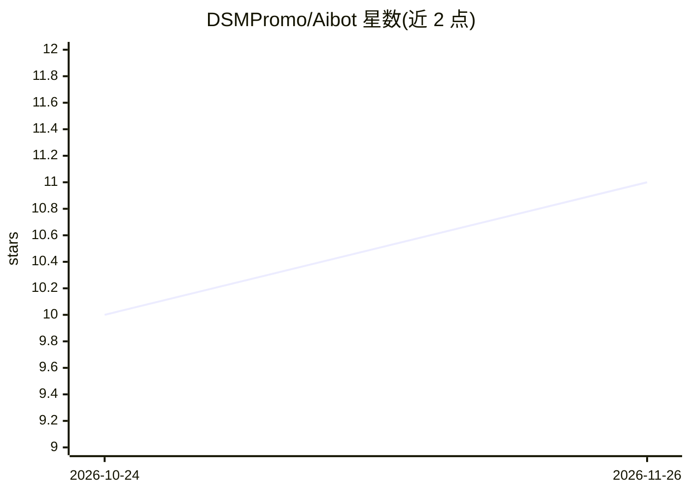

# DSMPromo/Aibot

⭐ 11 · Python · MIT · 推送 2026-01-30 · [GitHub](https://github.com/DSMPromo/Aibot) · 个人维护

**为广告投放者提供跨 Google/Meta/TikTok 的 AI 营销自动化平台**

基于 FastAPI + React 的营销自动化平台，覆盖三大广告平台的统一投放管理：跨平台活动创建与定向、用 GPT-4 或 Claude 生成标题/描述/CTA 文案与 A/B 变体、实时指标看板（曝光/点击/转化/ROAS）、阈值触发的自动化规则（暂停/调价/通知）与审批流。内置 Stripe 订阅计费、多渠道通知与 HMAC 签名 webhook。通过 Docker Compose 一键部署，依赖各平台 API 密钥与 OpenAI/Anthropic 密钥。

## 筛选速览

| 维度 | 判定 | 备注 |
|---|---|---|
| AI 角色 | `ai-enhanced` | 去掉 AI 部分产品仍成立 |
| 许可风险 | `permissive` | MIT |
| 部署形态 | `self-host` | docker 或自建部署 |
| 模型依赖 | locked-api |  |
| 硬件要求 | — | 无带数字的原话,不猜 |
| 安装摩擦 | `low` | 无编译、无系统依赖或容器化 |
| 成熟度 | — | 结构信号不足 |

## 能力要点

- Google/Meta/TikTok 三平台统一活动管理与跨平台对比
- GPT-4 或 Claude 生成平台限字广告文案与 A/B 变体
- 阈值自动化规则（预算/CPA/ROAS）与审批工作流
- Stripe 订阅计费与 Prometheus/Grafana 监控栈

## 适用场景

- 在一个看板同时管理多个广告平台的活动
- 自动批量生成适配各平台字数限制的广告文案
- 按 CPA/ROAS 阈值自动暂停或调整出价并通知团队
- 为 SaaS 化运营配置订阅计费与用量限制

## 场景标签

`工作流自动化` `AI 写作` · 领域:效率与自动化

## 证据(README 行号)

> L3: AI-powered marketing automation platform for Google, Meta, and TikTok Ads. Manage campaigns across multiple platform
> L15: - Generate headlines, descriptions, and CTAs using GPT-4 or Claude

## 星数曲线

2026-10-24 10 → 2026-11-26 11（+1）

---
*卡片 v1 · prompt 1.4 · 生成 2026-11-20 · 置信度 high · 依据 README sha `24140602bb7d` · [字段定义](../../DATASET.md)*
