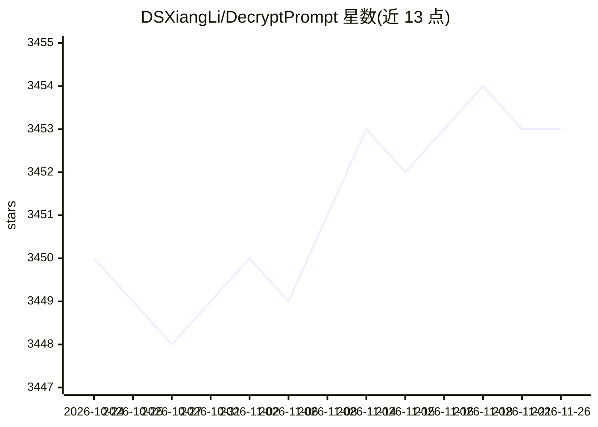

# DSXiangLi/DecryptPrompt

⭐ 3,453 · 推送 2026-11-16 · [GitHub](https://github.com/DSXiangLi/DecryptPrompt) · 个人维护 · 中文 README

**Prompt与LLM论文解读博客及资源汇总清单**

以「解密Prompt」系列博客为核心的论文解读与资源汇总仓库：持续更新 70+ 篇 Prompt/CoT/RLHF/Agent/RAG 主题的论文串读文章，另汇总开源模型评测榜单、微调与预训练数据集、推理/微调/Agent/RAG 框架、AIGC 应用与 Prompt 教程等资源链接，并按 Harness、Skill Evolution、图像生成、Post Train、Context Engineering、模型架构等类别整理论文列表。面向学习 LLM/Prompt 技术的研究者与开发者，内容以链接目录形式组织，不含可运行代码。

## 筛选速览

| 维度 | 判定 | 备注 |
|---|---|---|
| AI 角色 | `ai-knowledge` | 知识聚合/清单类 |
| 许可风险 | `none` | — |
| 部署形态 | `None` |  |
| 模型依赖 | — | README 未给出锁定关系 |
| 硬件要求 | — | 无带数字的原话,不猜 |
| 安装摩擦 | `low` | 无编译、无系统依赖或容器化 |
| 成熟度 | — | 结构信号不足 |

## 能力要点

- 70+ 篇「解密Prompt」系列论文解读博客，覆盖 Prompt/CoT/RLHF/Agent/RAG/MCP
- 汇总开源模型评测榜单、SFT/RLHF/Pretrain 数据集与各类框架资源
- 按 Harness、Skill Evolution、Post Train、Context Engineering 等类别整理论文列表
- 「和AI一起搞事情」系列实战复盘文章

## 适用场景

- 系统学习 Prompt 工程与思维链相关论文
- 查找 RLHF、Agent 训练、RAG 优化的文献与开源数据集入口
- 跟进 LLM 推理缩放与 Context Engineering 的最新论文

## 场景标签

`教程课程` `精选清单` · 领域:学习与行业

## 证据(README 行号)

> L13: ## 跟着博客读论文
> L98: ## 论文汇总
> L6: - 开源模型和评测榜单

## 星数曲线

2026-10-24 3,450 → 2026-11-26 3,453（+3）

---
*卡片 v1 · prompt 1.4 · 生成 2026-11-23 · 置信度 high · 依据 README sha `d576597035c0` · [字段定义](../../DATASET.md)*
