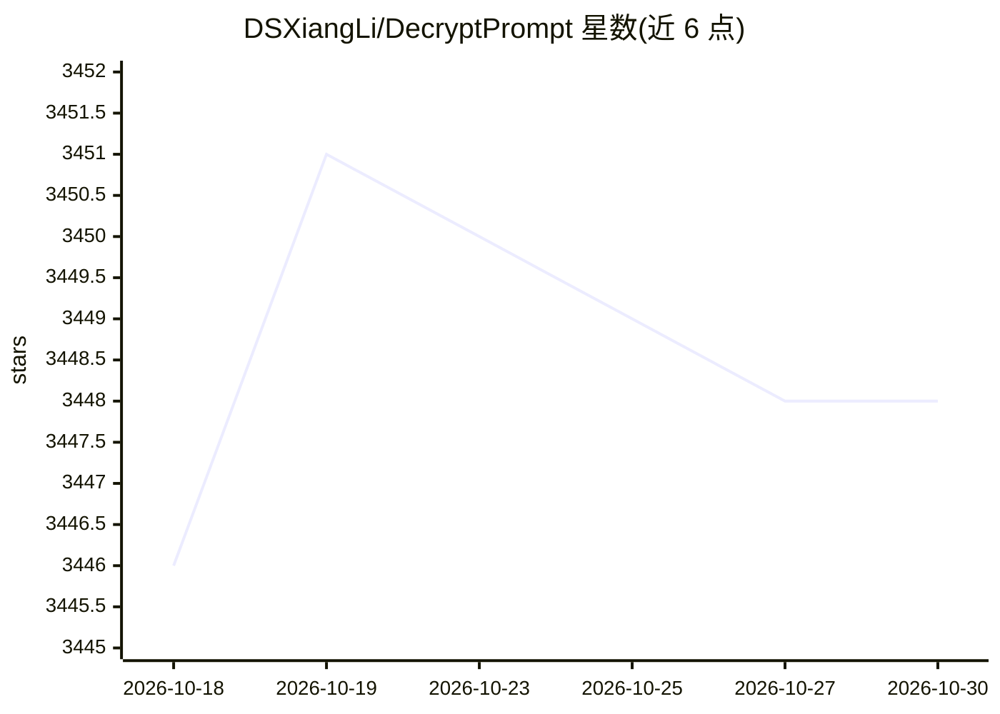

# DSXiangLi/DecryptPrompt

⭐ 3,448 · 推送 2026-10-26 · [GitHub](https://github.com/DSXiangLi/DecryptPrompt) · 个人维护 · 中文 README

**LLM/Prompt 论文与资源中文汇总仓库（博客+清单）**

个人维护的中文 LLM 知识汇总仓库：以'解密Prompt'系列博客（72 篇）为主线覆盖 Prompt、COT、RLHF、RAG、Agent、MCP 等主题，配套论文分类清单（Harness、Skill Evolution、Post Train、Context Engineer、新模型架构等），并汇总开源模型榜单、推理/微调/Agent/RAG 框架、SFT/RLHF 数据集与 AIGC 应用等资源链接。另含'和AI一起搞事情'实战记录系列。无安装运行实体，以阅读检索为主。

## 筛选速览

| 维度 | 判定 | 备注 |
|---|---|---|
| AI 角色 | `ai-knowledge` | 知识聚合/清单类 |
| 许可风险 | `none` | — |
| 部署形态 | `None` |  |
| 模型依赖 | — | README 未给出锁定关系 |
| 硬件要求 | — | 无带数字的原话,不猜 |
| 安装摩擦 | `low` | 无编译、无系统依赖或容器化 |
| 成熟度 | — | 结构信号不足 |

## 能力要点

- 72 篇'解密Prompt'中文博客覆盖 Prompt/COT/RLHF/RAG/Agent
- 论文按 Harness、Skill Evolution、Post Train、Context Engineer 等主题分类汇总
- LLM 资源汇总：开源模型榜单、框架、数据集、AIGC 应用

## 适用场景

- 系统跟进 Prompt、思维链与 Agent 方向的论文脉络
- 查找 LLM 推理、微调、RAG 相关的开源框架与数据集
- 阅读中文解读博客入门 LLM 各子领域

## 场景标签

`精选清单` `教程课程` · 领域:学习与行业

## 证据(README 行号)

> L5: ## LLM资源汇总
> L13: ## 跟着博客读论文
> L97: ## 论文汇总

## 星数曲线

2026-10-18 3,446 → 2026-10-30 3,448（+2）

---
*卡片 v1 · prompt 1.4 · 生成 2026-10-20 · 置信度 high · 依据 README sha `2304d00b45ad` · [字段定义](../../DATASET.md)*
