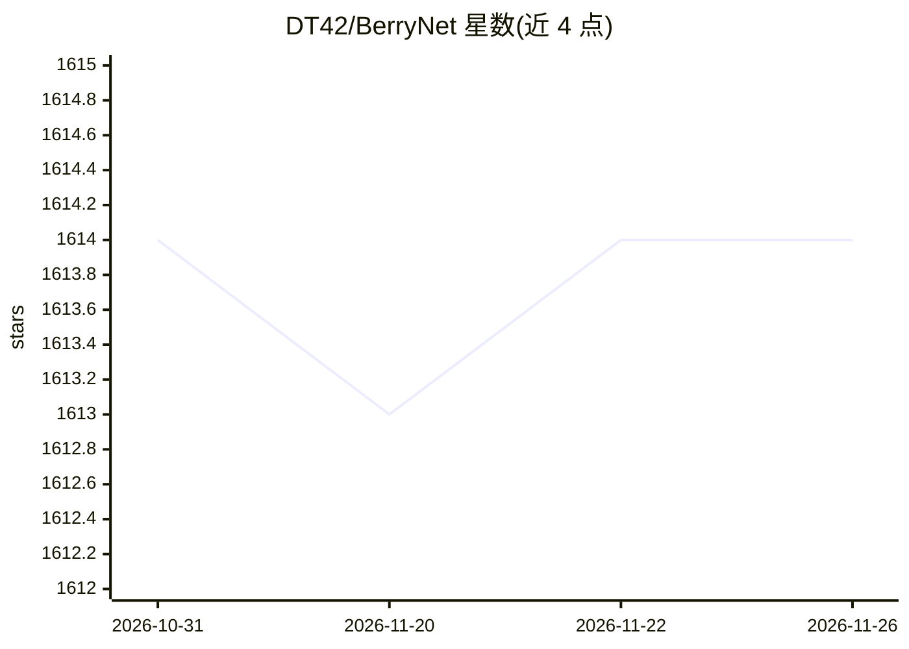

# DT42/BerryNet

⭐ 1,614 · Python · GPL-3.0 · 推送 2026-10-31 · [GitHub](https://github.com/DT42/BerryNet) · [官网](https://dt42.io) · 组织维护

**把树莓派变成离线深度学习网关，本地分析摄像头图像**

在 Raspberry Pi 上运行的深度学习网关：摄像头帧与推理结果以 MQTT 消息经 Mosquitto broker 在组件间交换，由 supervisor 管理。提供分类（MobileNet）与目标检测（SSD MobileNet、Ultralytics YOLO）两类 AI 引擎，模型经 LiteRT 或 ONNX Runtime 运行，全程离线在边缘设备本地完成；检测结果可在 Freeboard 仪表盘展示，或经 Telegram/Gmail 客户端按标签发送通知，还可监听 Zigbee 土壤湿度传感器。需树莓派 4/5 及 64 位 Raspberry Pi OS。

## 筛选速览

| 维度 | 判定 | 备注 |
|---|---|---|
| AI 角色 | `ai-native` | 本体是模型或模型工具 |
| 许可风险 | `viral` | GPL-3.0 |
| 部署形态 | `self-host` | docker 或自建部署 |
| 模型依赖 | — | README 未给出锁定关系 |
| 硬件要求 | — | 无带数字的原话,不猜 |
| 安装摩擦 | `low` | 无编译、无系统依赖或容器化 |
| 成熟度 | — | 结构信号不足 |

## 能力要点

- 目标检测与图像分类双引擎，LiteRT/ONNX Runtime 两种运行时可选
- 组件经 MQTT（Mosquitto）交换数据，supervisor 统一管理
- 离线运行，支持多边缘设备组成分布式 AIoT 网络
- 支持 YOLO26 模型导出后端到端推理，并提供 Telegram/Gmail 通知客户端

## 适用场景

- 用摄像头监控场所，检测到特定目标时经 Telegram 或邮件提醒
- 在无互联网的边缘环境本地运行图像分析
- 监听 Zigbee 土壤湿度传感器并向 Telegram 推送告警与定时报告
- 将快照与推理结果存档用于后续数据分析

## 场景标签

`目标检测` · 领域:感知与多模态

## 证据(README 行号)

> L14: This project turns Raspberry Pi into an intelligent gateway with deep learning running on it. No internet connectio
> L22: Figure 1 shows the software architecture of the project, we use Python, MQTT and AI engines to analyze images or vi

## 星数曲线

2026-10-31 1,614 → 2026-11-26 1,614（+0）

---
*卡片 v1 · prompt 1.4 · 生成 2026-11-23 · 置信度 mid · 依据 README sha `804d4eb06f0a` · [字段定义](../../DATASET.md)*
