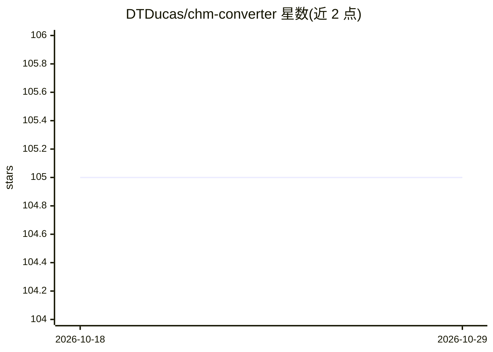

# DTDucas/chm-converter

⭐ 105 · Python · MIT · 推送 2026-09-04 · [GitHub](https://github.com/DTDucas/chm-converter) · [官网](https://dtducas.com/projects/chm-converter) · 个人维护 · 中文 README

**把 CHM 帮助文档转换为 Markdown 并生成检索索引的 Python 工具**

Python 编写的 Compiled HTML Help（.chm）转换工具：通过 7-Zip 解包 CHM，经配置文件驱动的流水线（generic/revit 两种 profile）输出清理后的 Markdown，自动检测 UTF-8/GB18030/GBK 等编码，保留代码块与表格结构。专为 Autodesk Revit API 文档构建，generic profile 可用于任意 CHM。输出含 file_index.json、id_lookup.json 与 index.md，供 RAG 和 AI 搜索流水线使用。跨平台运行，采用异步与批量处理应对 6000+ 页大文件。

## 筛选速览

| 维度 | 判定 | 备注 |
|---|---|---|
| AI 角色 | `ai-ecosystem` | LLM/agent 周边工具 |
| 许可风险 | `permissive` | MIT |
| 部署形态 | `desktop` | 安装包/桌面程序 |
| 模型依赖 | — | README 未给出锁定关系 |
| 硬件要求 | — | 无带数字的原话,不猜 |
| 安装摩擦 | `low` | 无编译、无系统依赖或容器化 |
| 成熟度 | — | 结构信号不足 |

## 能力要点

- generic/revit 双 profile 转换，revit 剥离帮助查看器 UI 杂项
- 自动编码检测（UTF-8/GB18030/GBK/GB2312 等）
- 生成 file_index.json/id_lookup.json/index.md 供 RAG 与 AI 搜索集成
- 异步+批量处理，支持 6000+ 页大文件与 7z/7za/7zz 跨平台检测

## 适用场景

- 把 Revit API 等 CHM 帮助文档转成 Markdown 用于 RAG 知识库
- 批量转换遗留 CHM 文档为可检索的 Markdown 结构
- 为 AI 搜索流水线准备带关键词索引的文档语料

## 场景标签

`文档解析` · 领域:知识与检索

## 证据(README 行号)

> L95: The `core/` folder is designed for RAG and AI search pipelines:
> L97: - `file_index.json` — maps every file ID to its title, filename, and version

## 星数曲线

2026-10-18 105 → 2026-10-29 105（+0）

---
*卡片 v1 · prompt 1.4 · 生成 2026-10-23 · 置信度 mid · 依据 README sha `6e4450792825` · [字段定义](../../DATASET.md)*
