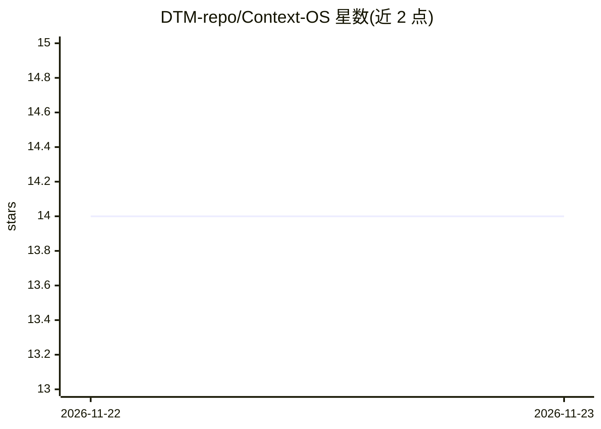

# DTM-repo/Context-OS

⭐ 14 · Shell · MIT · 推送 2026-09-30 · [GitHub](https://github.com/DTM-repo/Context-OS) · [官网](https://readthemanifest.net) · 个人维护

**为 AI 代理提供可移植的 Markdown 上下文与加载规则**

一组普通 Markdown 文件加加载规则组成的上下文层：用户一次性填写个人背景、项目状态、技术栈与隐私文件，Claude Code、Codex、ChatGPT、Gemini、Cursor 或本地模型按 MANIFEST.md 定义的 0-4 级加载规则读取对应文件，免去每次会话重复说明。隐私文件默认 git-ignore 且按任务手动启用；会话结束由代理提议更新补丁、用户批准后写入。无运行时、无安装、无依赖，MIT 许可，另有 readthemanifest.net 网页版可通过 MCP 链接提供同一层。

## 筛选速览

| 维度 | 判定 | 备注 |
|---|---|---|
| AI 角色 | `ai-knowledge` | 知识聚合/清单类 |
| 许可风险 | `permissive` | MIT |
| 部署形态 | `None` |  |
| 模型依赖 | — | README 未给出锁定关系 |
| 硬件要求 | — | 无带数字的原话,不猜 |
| 安装摩擦 | `low` | 无编译、无系统依赖或容器化 |
| 成熟度 | — | 结构信号不足 |

## 能力要点

- MANIFEST.md 定义 0-4 级按需加载规则，按任务规模读取最小文件集
- *_PRIVATE.md 隐私文件默认 git-ignore、按任务 opt-in
- 会话结束由代理提议上下文更新补丁，用户批准后写入
- 提供 CLAUDE.md/AGENTS.md 入口与 prompts/ 复用提示词，适配未知工具含自适配机制

## 适用场景

- 在多个 AI 工具间切换时保持同一份项目背景与工作约定
- 编码会话只加载技术栈与单个项目的最小上下文
- 把敏感信息隔离在本地，避免提交或泄露给无关工具

## 场景标签

`Agent 记忆` · 领域:Agent 开发

## 证据(README 行号)

> L3: **A portable, plain-Markdown context layer for AI agents.** Stop re-explaining who you are, what you're working on, 
> L39: `MANIFEST.md` tells the agent how much to load:
> L96: - **Plain Markdown, no lock-in.** Every file is human-readable and tool-agnostic. No runtime, no install.

## 星数曲线

2026-11-22 14 → 2026-11-23 14（+0）

---
*卡片 v1 · prompt 1.4 · 生成 2026-11-22 · 置信度 high · 依据 README sha `ae396c438c10` · [字段定义](../../DATASET.md)*
