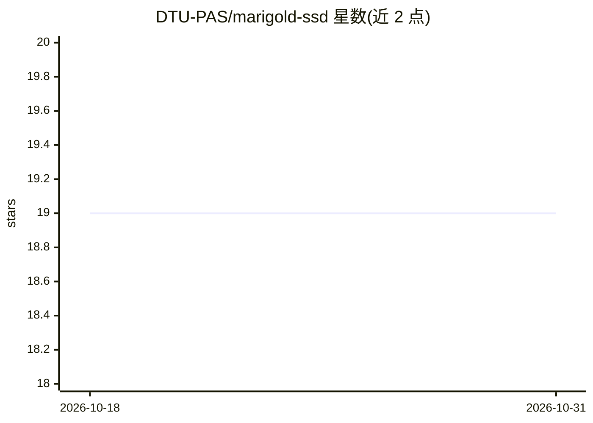

# DTU-PAS/marigold-ssd

⭐ 19 · Python · 推送 2026-06-01 · [GitHub](https://github.com/DTU-PAS/marigold-ssd) · [官网](https://dtu-pas.github.io/marigold-ssd/) · 组织维护

**单步扩散零样本深度补全的官方实现（CVPRW 2026）**

论文 Need for Speed: Zero-Shot Depth Completion with Single-Step Diffusion 的官方代码实现：基于单步扩散模型融合稀疏深度点与图像，生成稠密深度图，面向零样本跨域评测。提供 Conda 环境与 pip 依赖安装流程，需配置 DATASETS_DIR 与 MODELS_DIR 环境变量；训练使用 Hypersim 与 Virtual KITTI 数据集，评测覆盖 ScanNet、IBims-1、NYUv2、VOID、KITTI DC、DDAD 等多个数据集，并提供可下载的预训练模型与训练/评测脚本。面向计算机视觉研究者与开发者。

## 筛选速览

| 维度 | 判定 | 备注 |
|---|---|---|
| AI 角色 | `ai-native` | 本体是模型或模型工具 |
| 许可风险 | `none` | — |
| 部署形态 | `desktop` | 安装包/桌面程序 |
| 模型依赖 | — | README 未给出锁定关系 |
| 硬件要求 | — | 无带数字的原话,不猜 |
| 安装摩擦 | `low` | 无编译、无系统依赖或容器化 |
| 成熟度 | — | 结构信号不足 |

## 能力要点

- 单步扩散模型的零样本深度补全
- 官方提供训练与评测脚本（ssd_train / ssd_eval）
- 预训练模型（ssd.zip、ssd-sparser.zip）可下载
- 多数据集评测（ScanNet/NYUv2/KITTI DC/VOID/DDAD 等）

## 适用场景

- 在稀疏深度点与图像输入上生成稠密深度图
- 复现论文的训练与零样本评测流程
- 跨域深度补全方法的研究与对比

## 场景标签

`模型训练` · 领域:训练与推理

## 证据(README 行号)

> L1: Need for Speed: Zero-Shot Depth Completion with Single-Step Diffusion
> L7: This is the official implementation of "Need for Speed: Zero-Shot Depth Completion with Single-Step Diffusion"
> L115: The models can be trained by the following scripts:

## 星数曲线

2026-10-18 19 → 2026-10-31 19（+0）

---
*卡片 v1 · prompt 1.4 · 生成 2026-10-29 · 置信度 mid · 依据 README sha `0e71d613388d` · [字段定义](../../DATASET.md)*
