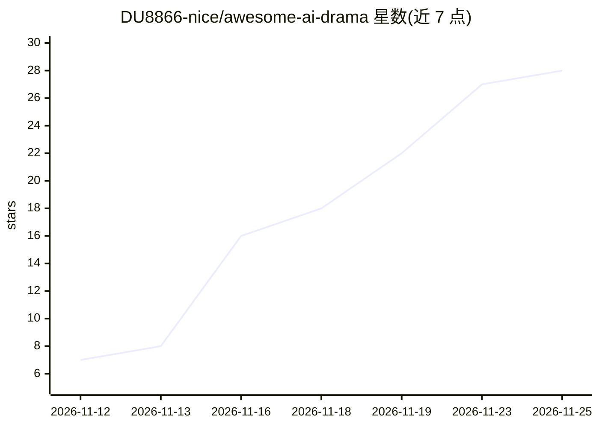

# DU8866-nice/awesome-ai-drama

⭐ 28 · Python · CC0-1.0 · 推送 2026-11-23 · [GitHub](https://github.com/DU8866-nice/awesome-ai-drama) · 个人维护 · 中文 README

**AI 短剧/漫剧全流程开源工具清单，供创作选型**

按制作流程组织的 AI 短剧与漫剧开源工具精选清单：覆盖一站式创作平台、Agent 剧本分镜技能包、开源视频生成模型、角色一致性图像模型、TTS 配音、口型同步、配乐音效、剪辑字幕、解说二创、ComfyUI 生态与提示词库，另列商用平台与国内合规规定摘要。条目标注星标数与最近更新时间，数据每周自动刷新、按热度重排序，README 由脚本从 data/tools.yaml 生成。面向想组建 AI 短剧制作流程的创作者与开发者。

## 筛选速览

| 维度 | 判定 | 备注 |
|---|---|---|
| AI 角色 | `ai-knowledge` | 知识聚合/清单类 |
| 许可风险 | `viral` | CC0-1.0 |
| 部署形态 | `None` |  |
| 模型依赖 | — | README 未给出锁定关系 |
| 硬件要求 | — | 无带数字的原话,不猜 |
| 安装摩擦 | `medium` | 含编译或系统依赖之一 |
| 成熟度 | — | 结构信号不足 |

## 能力要点

- 按剧本→分镜→出图出视频→配音→剪辑→发布的流程组织条目
- 条目附星标数与最近更新时间，数据每周自动刷新
- 收录中国大陆 AI 生成内容标识与微短剧管理规定摘要
- 提供零代码/一站式/全本地/Agent 工作流四条选型路线

## 适用场景

- 找开源工具搭一条从剧本到成片的 AI 短剧制作流程
- 查找角色一致性、口型同步等专项环节的模型与工具
- 了解国内微短剧发布前的合规备案要求

## 场景标签

`精选清单` · 领域:学习与行业

## 证据(README 行号)

> L7: 从剧本、分镜、角色一致性、视频生成、配音口型到剪辑和合规发布，AI 短剧与漫剧全流程的开源工具精选。每个项目都标注了星标数和最近更新时间，数据每周自动刷新、按热度重新排序。
> L11: AI 漫剧已经是短剧的主力：澎湃号的一篇文章援引中国网络视听协会的数据称，2026 年一季度全行业上线微短剧约 12.8 万部，其中 AI 微短剧约 12.2 万部。开源社区里相关项目也在爆发，但散落在各处、良莠不齐。这里把**真

## 星数曲线

2026-11-12 7 → 2026-11-25 28（+21）

---
*卡片 v1 · prompt 1.4 · 生成 2026-11-18 · 置信度 high · 依据 README sha `8c4caf3d1226` · [字段定义](../../DATASET.md)*
