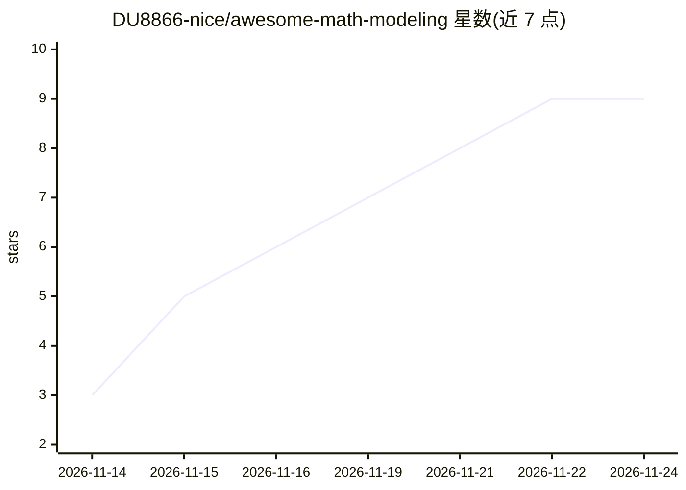

# DU8866-nice/awesome-math-modeling

⭐ 10 · Python · CC0-1.0 · 推送 2026-11-23 · [GitHub](https://github.com/DU8866-nice/awesome-math-modeling) · 个人维护 · 中文 README

**数学建模竞赛的 AI 工具与资源策展清单（120 项）**

面向国赛 CUMCM、美赛 MCM/ICM、华为杯研赛等数学建模竞赛的资源清单，收录 120 个项目并按用途分为全流程 Agent 应用、全流程/专项 Skill、论文评审自查、LaTeX/Typst 模板、教程资料、算法代码库和真题获奖论文等板块。每个条目标注星标数、最近更新时间与适用赛事，数据每周自动刷新；清单前置各赛事的 AI 使用规定（是否可用、需提交的声明材料、违规后果），并按工作方式（全自动/人机协作/引导式）打标签。

## 筛选速览

| 维度 | 判定 | 备注 |
|---|---|---|
| AI 角色 | `ai-knowledge` | 知识聚合/清单类 |
| 许可风险 | `viral` | CC0-1.0 |
| 部署形态 | `library` | 以包/库形式分发 |
| 模型依赖 | — | README 未给出锁定关系 |
| 硬件要求 | — | 无带数字的原话,不猜 |
| 安装摩擦 | `low` | 无编译、无系统依赖或容器化 |
| 成熟度 | — | 结构信号不足 |

## 能力要点

- 收录 120 个项目，覆盖 Agent 应用、Skill、模板、算法库、真题论文等类别
- 前置美赛、国赛、华为杯的 AI 使用规定与需提交的披露材料说明
- 每个条目标注星标数、最近更新时间和工作方式标签（全自动/人机协作/引导式等）
- 数据每周自动刷新，附按参赛者情况的选择指引表

## 适用场景

- 备赛数学建模竞赛时查找 AI Agent 和 skill 工具
- 赛前查阅各赛事的 AI 使用规定与披露要求
- 找国赛/美赛/华为杯的 LaTeX 论文模板
- 赛后查找优秀论文和算法代码库学习

## 场景标签

`精选清单` · 领域:学习与行业

## 证据(README 行号)

> L7: > 数学建模竞赛（国赛 CUMCM、美赛 MCM/ICM、华为杯研赛等）的 AI Agent、Skill、论文模板、算法代码、获奖论文和求解器精选。每个项目都标注星标数和最近更新时间，数据每周自动刷新。
> L11: 这份清单把能用、仍在维护的项目按用途整理好，并把各赛事的 AI 规定放在最前面，用之前先弄清楚边界。

## 星数曲线

2026-11-14 3 → 2026-11-24 9（+6）

---
*卡片 v1 · prompt 1.4 · 生成 2026-11-20 · 置信度 mid · 依据 README sha `2b4c45765d6a` · [字段定义](../../DATASET.md)*
