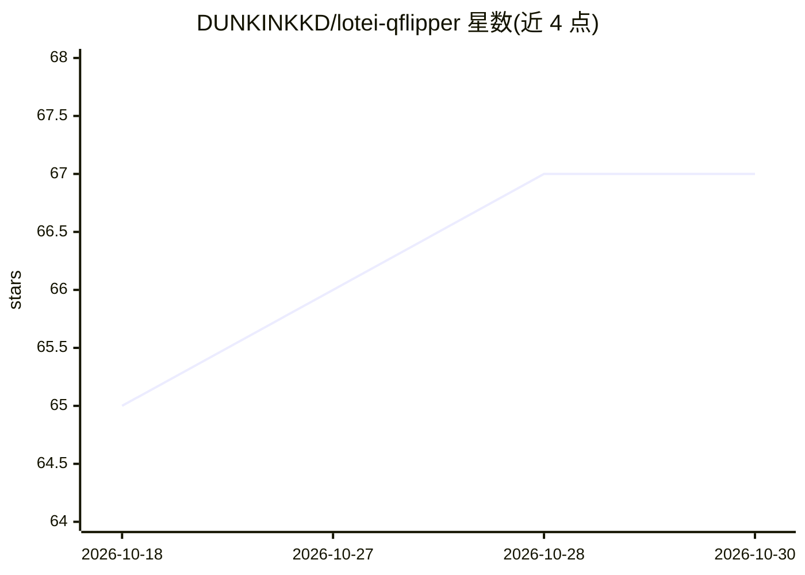

# DUNKINKKD/lotei-qflipper

⭐ 67 · C++ · GPL-3.0 · 推送 2026-07-18 · [GitHub](https://github.com/DUNKINKKD/lotei-qflipper) · [官网](https://github.com/DUNKINKKD/lotei-qflipper/releases/latest) · 个人维护

**qFlipper 非官方分支：内置 Ollama 本地 AI 海豚助手与粉红主题**

Flipper Zero 桌面应用 qFlipper 的非官方分支：在上游固件管理与设备连接功能之上加入 LOTEI——一个基于 Ollama + qwen2.5:7b 的纯本地 AI 聊天助手，带 agentic 工具（读取 SD 卡、保存脚本、通过 RPC 链按设备按键），并集成 Piper 离线语音合成、设备 128×64 屏幕实时镜像、运行时全局换色编辑器与音乐播放。面向 Flipper Zero 用户，面向 Windows 10/11（源码构建，MSVC + Qt 6.4.2）与 Linux（发布 AppImage）。AI 与语音依赖本机安装 Ollama 与可选 Piper，无 API key、无云端。

## 筛选速览

| 维度 | 判定 | 备注 |
|---|---|---|
| AI 角色 | `ai-enhanced` | 去掉 AI 部分产品仍成立 |
| 许可风险 | `viral` | GPL-3.0 |
| 部署形态 | `desktop` | 安装包/桌面程序 |
| 模型依赖 | local-ok | 支持本地模型 |
| 硬件要求 | `gpu-8g` | |
| 安装摩擦 | `medium` | 含编译或系统依赖之一 |
| 成熟度 | — | 结构信号不足 |

## 能力要点

- LOTEI 本地 AI 助手（Ollama + qwen2.5:7b），带可操作设备的 agentic 工具
- Piper 离线神经语音合成，缺省时回退 Windows SAPI
- 设备 128×64 屏幕实时镜像显示于聊天面板
- 运行时全 UI 换色编辑器与 Linux AppImage 发布

## 适用场景

- 管理 Flipper Zero 固件并通过对话让 AI 助手代为操作设备
- 纯本地、无 API key 地使用带语音的桌面 AI 助手
- 实时查看 Flipper 屏幕并浏览/写入 SD 卡文件

## 场景标签

`AI 助手` `语音合成` · 领域:对话与助手

## 证据(README 行号)

> L16: > **Unofficial fork** of qFlipper, the Flipper Zero desktop app. Not affiliated with or endorsed by Flipper Devices
> L24: - **🐬 LOTEI** — a local-AI chat assistant (Ollama + `qwen2.5:7b`) built right into the app: a flirty, vain, RAM-glu

## 星数曲线

2026-10-18 65 → 2026-10-30 67（+2）

---
*卡片 v1 · prompt 1.4 · 生成 2026-10-24 · 置信度 high · 依据 README sha `ade5410c2502` · [字段定义](../../DATASET.md)*
