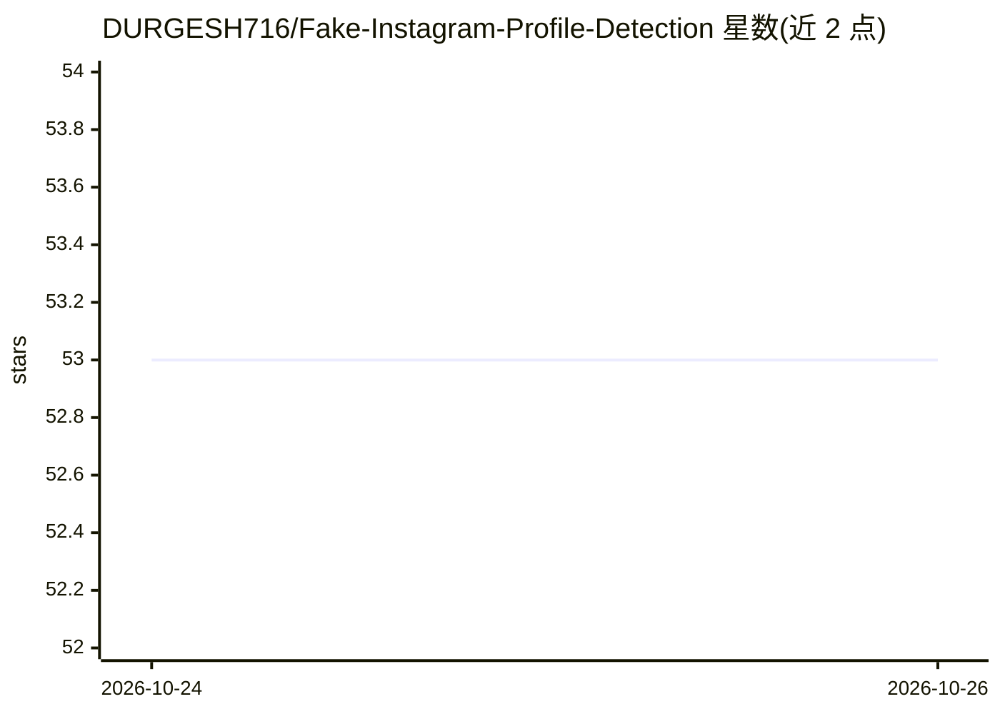

# DURGESH716/Fake-Instagram-Profile-Detection

⭐ 53 · Python · 推送 2026-10-23 · [GitHub](https://github.com/DURGESH716/Fake-Instagram-Profile-Detection) · 个人维护

**用 11 项档案元数据分类 Instagram 账号真假的神经网络**

前馈全连接神经网络分类器：基于用户名数字占比、简介长度、粉丝数等 11 个公开档案特征，将 Instagram 账号判定为虚假或真实。流程含探索性分析、StandardScaler 标准化（仅在训练集上拟合）、one-hot 编码，模型为 4 层 Dense 结构带 Dropout，Adam 优化训练 50 epochs。保留测试集上准确率 88%、虚假类召回 90%。README 声明数据集小、单一划分结果可能不泛化，且未与简单基线对比。使用方式为 clone 后 pip 安装依赖并运行 notebook。

## 筛选速览

| 维度 | 判定 | 备注 |
|---|---|---|
| AI 角色 | `ai-native` | 本体是模型或模型工具 |
| 许可风险 | `none` | — |
| 部署形态 | `library` | 以包/库形式分发 |
| 模型依赖 | — | README 未给出锁定关系 |
| 硬件要求 | — | 无带数字的原话,不猜 |
| 安装摩擦 | `low` | 无编译、无系统依赖或容器化 |
| 成熟度 | — | 结构信号不足 |

## 能力要点

- 11 个公开档案元数据特征输入的 Dense 网络分类
- StandardScaler 仅在训练集拟合以避免数据泄漏
- 保留测试集上准确率 88%、虚假类 F1 89%
- 附带探索性分析（类别平衡、缺失值、相关性热图）

## 适用场景

- 我想自动筛查疑似虚假的 Instagram 账号
- 作为机器学习课程或 Kaggle 练习的分类项目参考
- 了解档案元数据能否用于虚假账号识别

## 场景标签

 · 领域:机器学习/社交媒体分析

## 证据(README 行号)

> L3: A feed-forward neural network that classifies Instagram accounts as **fake** or **genuine** using profile-level meta
> L34: 1. **Exploratory analysis:** class balance, missing values, feature distributions, and a correlation heatmap.

## 星数曲线

2026-10-24 53 → 2026-10-26 53（+0）

---
*卡片 v1 · prompt 1.4 · 生成 2026-10-24 · 置信度 mid · 依据 README sha `039094312f12` · [字段定义](../../DATASET.md)*
