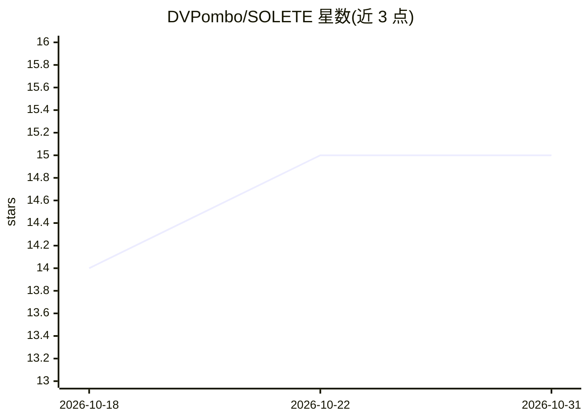

# DVPombo/SOLETE

⭐ 15 · Python · MIT · 推送 2026-10-15 · [GitHub](https://github.com/DVPombo/SOLETE) · 个人维护

**风-光-气象 colocated 数据集清洗与机器学习预测工具包**

SOLETE 项目的一体化仓库，包含两半：数据清洗与质量控制流水线（将 15 个月、1 秒分辨率的 colocated 风机+光伏+气象原始记录处理为带 11 种 QC 标记的 v4 版数据集，数据本体存于 figshare），以及建立其上的机器学习预测平台（Random Forest、SVM、CNN、LSTM、CNN-LSTM 及梯度提升、persistence/climatology 基线）。面向时间序列预测与机器学习学习者，提供快速入门脚本、五个可在小样本上运行的 notebook、可复现基准与已知问题文档。风电通道在数据集中 99.56% 为零，风/混合结果被声明为基础设施而非结论。

## 筛选速览

| 维度 | 判定 | 备注 |
|---|---|---|
| AI 角色 | `ai-native` | 本体是模型或模型工具 |
| 许可风险 | `permissive` | MIT |
| 部署形态 | `library` | 以包/库形式分发 |
| 模型依赖 | — | README 未给出锁定关系 |
| 硬件要求 | — | 无带数字的原话,不猜 |
| 安装摩擦 | `low` | 无编译、无系统依赖或容器化 |
| 成熟度 | — | 结构信号不足 |

## 能力要点

- 原始 1 秒数据经 11 种 QC 编码标记清洗为 v4 版数据集（hdf5/parquet 多分辨率）
- 提供 RF/SVM/CNN/LSTM/CNN-LSTM 等预测模型训练与保存模型推理路径
- 五个示例 notebook 附 Colab 徽章，可在捆绑小样本上直接运行
- 含固定 train/val/test 划分与附注意事项的基准排行榜

## 适用场景

- 学习基于机器学习的时间序列预测（光伏/风电功率）
- 获取并理解带质量控制标记的风光 colocated 数据集
- 复现或扩展论文中的预测方法与基准
- 在自建项目中加载带质量标记的清洗后数据

## 场景标签

`教程课程` · 领域:学习与行业

## 证据(README 行号)

> L30: 1. **The cleaning & quality-control pipeline** (`dataset/` + the core `solete/{paths,h5io,qc_codes,qc,expansion,phy
> L31: 2. **The forecasting platform** (`solete/{preprocessing,modeling,postprocess,metrics,dataset.py}` + `benchmarks/` +
> L148: 3. Open **scripts/quickstart/MLForecasting.py**. This allows you to configure Random Forest (RF), Support Vector M

## 星数曲线

2026-10-18 14 → 2026-10-31 15（+1）

---
*卡片 v1 · prompt 1.4 · 生成 2026-10-31 · 置信度 high · 依据 README sha `ffadda6c3844` · [字段定义](../../DATASET.md)*
