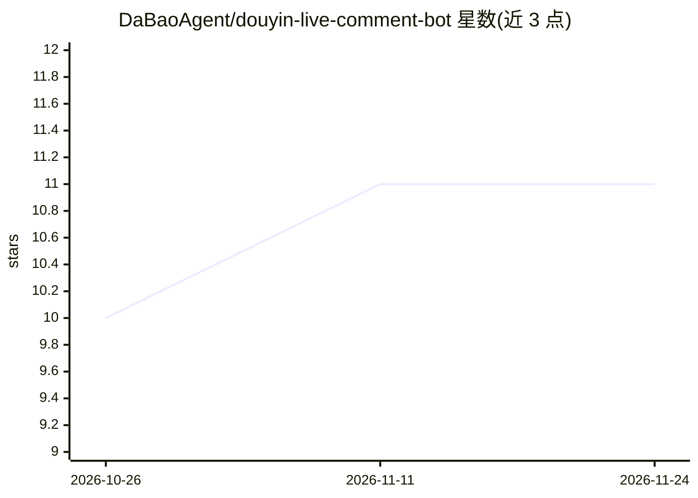

# DaBaoAgent/douyin-live-comment-bot

⭐ 11 · JavaScript · 推送 2026-08-02 · [GitHub](https://github.com/DaBaoAgent/douyin-live-comment-bot) · 个人维护 · 中文 README

**给抖音主播/运营在直播间自动点赞和生成评论的 Chrome 扩展**

一款运行在抖音直播间页面的 Chrome 扩展，提供自动点赞、点赞频率调节与操作日志记录（免费版）；AI 智能评论为 VIP 付费功能，由 DeepSeek 驱动，根据直播间实时内容生成评论，可自定义角色视角与评论间隔。安装方式为下载 ZIP 后在 chrome://extensions 开发者模式下加载已解压目录，支持 Chrome 及 Chromium 内核浏览器，会员通过机器码绑定的离线授权开通。

## 筛选速览

| 维度 | 判定 | 备注 |
|---|---|---|
| AI 角色 | `ai-enhanced` | 去掉 AI 部分产品仍成立 |
| 许可风险 | `none` | — |
| 部署形态 | `None` |  |
| 模型依赖 | — | README 未给出锁定关系 |
| 硬件要求 | — | 无带数字的原话,不猜 |
| 安装摩擦 | `low` | 无编译、无系统依赖或容器化 |
| 成熟度 | — | 结构信号不足 |

## 能力要点

- 自动点赞与自定义点赞频率
- DeepSeek 驱动的直播间内容匹配评论生成（VIP）
- 可自定义评论角色设定与间隔时间
- 离线授权与机器码绑定（v3.0.0）

## 适用场景

- 在热门直播间自动评论为账号引流
- 提升自己直播间的互动数据
- 同时管理多个账号的直播间互动

## 场景标签

`浏览器自动化` `AI 写作` · 领域:效率与自动化

## 证据(README 行号)

> L15: **大宝抖音AI托评助手**是一款专为抖音直播间设计的 Chrome 浏览器扩展，帮助主播和运营人员高效截流引流。
> L30: - 基于 **DeepSeek** 大模型，评论自然真实，不像机器人

## 星数曲线

2026-10-26 10 → 2026-11-24 11（+1）

---
*卡片 v1 · prompt 1.4 · 生成 2026-11-19 · 置信度 mid · 依据 README sha `917ccaf95fb2` · [字段定义](../../DATASET.md)*
