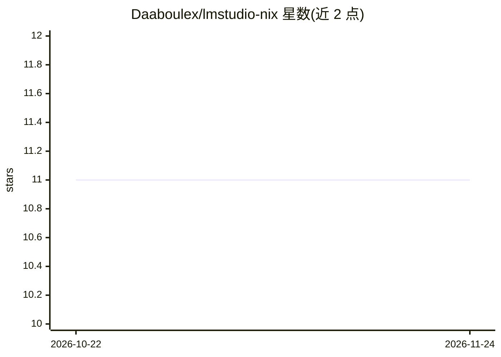

# Daaboulex/lmstudio-nix

⭐ 11 · Nix · NOASSERTION · 推送 2026-11-22 · [GitHub](https://github.com/Daaboulex/lmstudio-nix) · 个人维护

**为 NixOS 打包 LM Studio：本地 LLM 推理的桌面应用与无头服务器**

将 LM Studio 打包为 Nix flake，提供桌面应用（stable/beta 通道）、Bionic agent 桌面应用以及带 `lms` CLI 的无头服务器，运行于 x86-64 与 arm64 Linux。提供 NixOS module（systemd 服务、`lmstudio` 用户/组）与 Home Manager module，支持 OpenAI 兼容 API 服务与模型管理。LM Studio 自行下载 llama.cpp 引擎，打包负责注入 CUDA/ROCm/Vulkan 库与驱动路径。已知限制包括 arm64 无 ROCm、CI 不加载模型或使用 GPU。

## 筛选速览

| 维度 | 判定 | 备注 |
|---|---|---|
| AI 角色 | `ai-ecosystem` | LLM/agent 周边工具 |
| 许可风险 | `none` | NOASSERTION |
| 部署形态 | `None` |  |
| 模型依赖 | local-ok | 支持本地模型 |
| 硬件要求 | — | 无带数字的原话,不猜 |
| 安装摩擦 | `medium` | 含编译或系统依赖之一 |
| 成熟度 | — | 结构信号不足 |

## 能力要点

- Nix flake 打包四个包：stable/beta 桌面应用、Bionic、无头服务器+`lms` CLI
- NixOS module 以 systemd daemon 方式运行服务并创建专用用户/组
- Home Manager module 为单用户安装桌面应用
- GPU 支持通过注入 CUDA/ROCm/Vulkan 库与驱动路径实现

## 适用场景

- 在 NixOS 上以声明式方式安装与管理 LM Studio 桌面应用
- 在多用户机器或服务器上以 daemon 方式运行本地 LLM API 服务
- 声明式配置 NVIDIA/AMD GPU 上的本地推理运行时

## 场景标签

`推理引擎` · 领域:训练与推理

## 证据(README 行号)

> L5: headless server with its `lms` CLI. It is for running local LLM inference on
> L100: LM Studio downloads its own llama.cpp engines. The packages supply the

## 星数曲线

2026-10-22 11 → 2026-11-24 11（+0）

---
*卡片 v1 · prompt 1.4 · 生成 2026-11-19 · 置信度 high · 依据 README sha `645f47e22941` · [字段定义](../../DATASET.md)*
