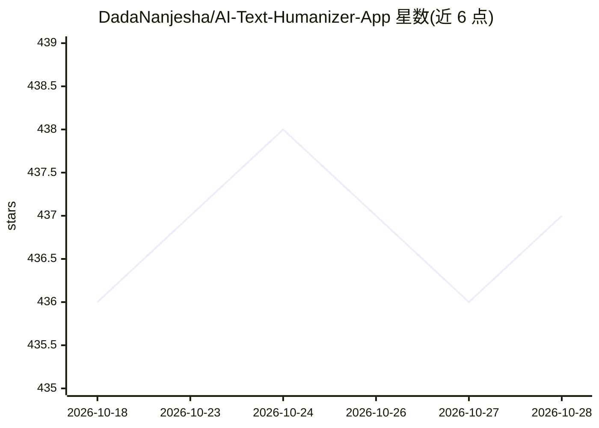

# DadaNanjesha/AI-Text-Humanizer-App

⭐ 437 · Python · MIT · 推送 2025-11-11 · [GitHub](https://github.com/DadaNanjesha/AI-Text-Humanizer-App) · [官网](https://ai-text-humanizer-app-by-dada.streamlit.app/) · 个人维护

**将 AI 生成文本改写为正式学术文风的网页应用**

基于 Streamlit 的文本改写应用，面向需要把 AI 生成或非正式文本转为正式学术文风的用户。处理机制为基于规则与经典 NLP 模型的转换：缩写展开（don't→do not）、添加学术过渡词、被动语态转换与同义词替换（后两者可选），并显示转换前后词数与句数统计。依赖 spaCy（en_core_web_sm）与 NLTK（punkt/wordnet/tagger）模型。本地运行需克隆仓库并 pip 安装依赖，另提供 Streamlit Cloud 部署说明；README 提示作者正在另一仓库开发新版本。

## 筛选速览

| 维度 | 判定 | 备注 |
|---|---|---|
| AI 角色 | `ai-native` | 本体是模型或模型工具 |
| 许可风险 | `permissive` | MIT |
| 部署形态 | `library` | 以包/库形式分发 |
| 模型依赖 | — | README 未给出锁定关系 |
| 硬件要求 | — | 无带数字的原话,不猜 |
| 安装摩擦 | `low` | 无编译、无系统依赖或容器化 |
| 成熟度 | — | 结构信号不足 |

## 能力要点

- 缩写展开、学术过渡词、被动语态转换与同义词替换等文本变换
- 转换前后词数与句数统计
- Streamlit 网页界面，粘贴或上传文本即可处理

## 适用场景

- 把 AI 生成的文本改写成正式学术文风
- 将口语化文本扩展缩写、调整为书面表达
- 在本地或 Streamlit Cloud 快速运行文本改写工具

## 场景标签

`AI 写作` · 领域:内容生成

## 证据(README 行号)

> L13: ✅ **AI-Powered Text Refinement**: Converts AI-generated or informal text into a more **academic** and **human-like*
> L19: ✅ **Streamlit Web Interface**: Use a simple **web app** to input, transform, and copy text effortlessly.
> L47: ### 4️⃣ Download NLP Models

## 星数曲线

2026-10-18 436 → 2026-10-28 437（+1）

---
*卡片 v1 · prompt 1.4 · 生成 2026-10-21 · 置信度 low · 依据 README sha `84f9d7e49c35` · [字段定义](../../DATASET.md)*
