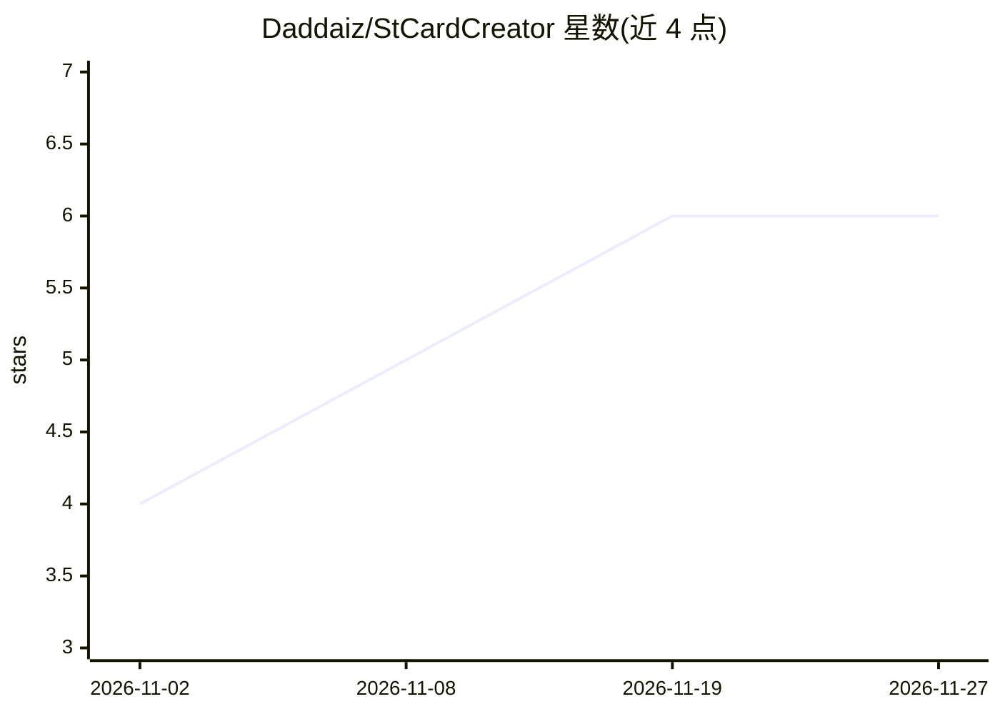

# Daddaiz/StCardCreator

⭐ 6 · HTML · MIT · 推送 2026-11-21 · [GitHub](https://github.com/Daddaiz/StCardCreator) · 个人维护

**为 SillyTavern 用户一站式制作角色卡的编辑器**

Electron/HTML 双形态的角色卡制作工具：在单页填写 SillyTavern 全部字段，实时统计 token，支持导入/导出内嵌数据的 PNG、JSON V2/V3、CHARX 与 TavernAI V1。AI 功能（字段改写、按描述生成、世界观条目建议、测试对话、图像生成）需自备 API；exe 版内置 Qwen Image 2.1 本地图像生成，自动下载 stable-diffusion.cpp 引擎与模型。HTML 版缺少与 SillyTavern 直接读写卡片的功能。

## 筛选速览

| 维度 | 判定 | 备注 |
|---|---|---|
| AI 角色 | `ai-enhanced` | 去掉 AI 部分产品仍成立 |
| 许可风险 | `permissive` | MIT |
| 部署形态 | `desktop` | 安装包/桌面程序 |
| 模型依赖 | — | README 未给出锁定关系 |
| 硬件要求 | — | 无带数字的原话,不猜 |
| 安装摩擦 | `low` | 无编译、无系统依赖或容器化 |
| 成熟度 | — | 结构信号不足 |

## 能力要点

- 单页编辑 SillyTavern 全部字段并实时统计 token
- 导出内嵌数据的 PNG（chara+ccv3）及 JSON V2/V3、CHARX、TavernAI V1 格式
- exe 版内置 Qwen Image 2.1 本地图像生成（基于 stable-diffusion.cpp）
- 提供字段改写、一致性检查与导出前测试对话

## 适用场景

- 为 SillyTavern 制作并导出角色卡 PNG
- 用 AI 按描述生成角色字段与世界书条目
- 本地显卡上生成角色封面图
- 批量导入已有卡片并检查与 SillyTavern 版本的差异

## 场景标签

`图像生成` · 领域:内容生成

## 证据(README 行号)

> L12: - Every SillyTavern field on one page. Live token counts, automatic drafts, undo for every AI action.
> L31: - Import a card PNG or JSON. Export a PNG with the data embedded (`chara` + `ccv3`), JSON V3 or V2, CHARX (RisuAI) 
> L38: |Everything else (card editor, cover, import/export, AI tools, Test chat)|✅|✅|

## 星数曲线

2026-11-02 4 → 2026-11-27 6（+2）

---
*卡片 v1 · prompt 1.4 · 生成 2026-11-20 · 置信度 high · 依据 README sha `4d45080a5bde` · [字段定义](../../DATASET.md)*
