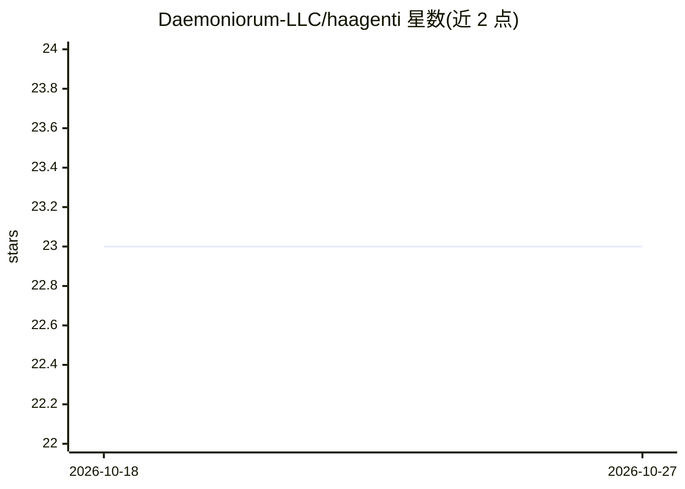

# Daemoniorum-LLC/haagenti

⭐ 23 · Rust · Apache-2.0 · 推送 2026-10-19 · [GitHub](https://github.com/Daemoniorum-LLC/haagenti) · 组织维护

**Rust 压缩库：用张量压缩在单消费级 GPU 上跑 70B+ 模型**

纯 Rust 实现的压缩库，包含通用算法（LZ4/Zstd/Brotli/Deflate，SIMD 加速、流式 API）与面向神经网络权重的 HCT 张量压缩格式（DCT 频谱编码、INT4 分块量化、渐进式重建）。README 称其 CUDA GPU 原生解压与重要性打分压缩可在 24GB 显存的 RTX 4500 Ada 上运行 70B 模型推理，但吞吐仍受张量库开销限制，25+ tokens/s 为项目预期而非实测。以多个 crate 分层组织，通过 cargo 安装，MIT OR Apache-2.0 双许可。

## 筛选速览

| 维度 | 判定 | 备注 |
|---|---|---|
| AI 角色 | `ai-ecosystem` | LLM/agent 周边工具 |
| 许可风险 | `permissive` | Apache-2.0 |
| 部署形态 | `None` |  |
| 模型依赖 | — | README 未给出锁定关系 |
| 硬件要求 | — | 无带数字的原话,不猜 |
| 安装摩擦 | `high` | 编译与系统依赖俱全 |
| 成熟度 | — | 结构信号不足 |

## 能力要点

- LZ4/Zstd/Brotli/Deflate 多算法，AVX2/AVX-512/NEON SIMD 加速与流式 API
- HCT 张量压缩格式：DCT 频谱编码、INT4 分块 FP16 scale 量化、渐进式重建
- CUDA 内核 GPU 原生解压与 cuFFT 加速 DCT，另有 WebGPU 支持
- 分层 crate 架构与 feature bundles（full/turbo/inference/sovereign）

## 适用场景

- 压缩神经网络权重以在单张消费级 GPU 上做本地推理
- 在 Rust 项目中使用 LZ4/Zstd/Brotli 等通用压缩算法
- 研究模型权重的频谱压缩与按需加载方案

## 场景标签

`模型量化` · 领域:训练与推理

## 证据(README 行号)

> L5: Haagenti is a pure Rust compression library that enables 70B+ parameter model inference on a single consumer GPU. Na
> L34: - **HCT (Haagenti Compressed Tensor)**: Purpose-built format for neural network weights

## 星数曲线

2026-10-18 23 → 2026-10-27 23（+0）

---
*卡片 v1 · prompt 1.4 · 生成 2026-10-27 · 置信度 mid · 依据 README sha `5da37e6628fa` · [字段定义](../../DATASET.md)*
