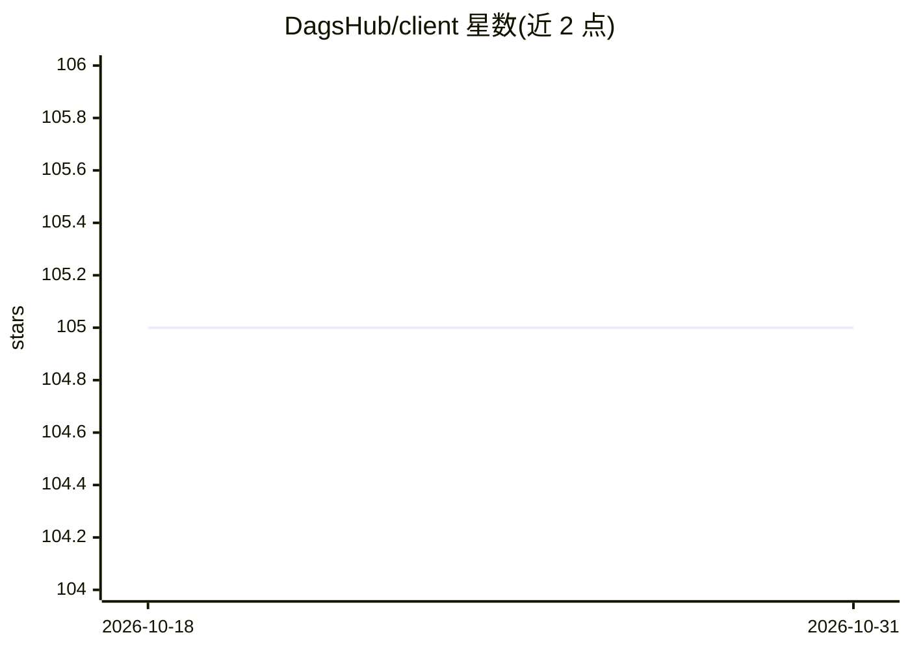

# DagsHub/client

⭐ 105 · Python · MIT · 推送 2026-10-26 · [GitHub](https://github.com/DagsHub/client) · [官网](https://dagshub.com/docs/client/) · 组织维护

**DagsHub 平台的 Python 客户端库：实验追踪与数据流式上传**

DagsHub（机器学习与数据科学团队协作平台）的官方客户端库，提供 API 与 CLI，由实验追踪（含自动记录 autologging）和 Direct Data Access（DDA）两大组件构成，支持通过 Python hooks 流式读取与上传项目数据，并保留版本与结构。平台本身围绕 Git、DVC、MLflow、Label Studio 等开放格式构建。部分功能仅支持 Python；DDA 需通过 dagshub login 认证；客户端默认收集使用分析，可用环境变量关闭。

## 筛选速览

| 维度 | 判定 | 备注 |
|---|---|---|
| AI 角色 | `ai-ecosystem` | LLM/agent 周边工具 |
| 许可风险 | `permissive` | MIT |
| 部署形态 | `library` | 以包/库形式分发 |
| 模型依赖 | — | README 未给出锁定关系 |
| 硬件要求 | — | 无带数字的原话,不猜 |
| 安装摩擦 | `low` | 无编译、无系统依赖或容器化 |
| 成熟度 | — | 结构信号不足 |

## 能力要点

- Experiment tracking 与自动记录（autologging）
- Direct Data Access：两行代码安装 hooks 即可流式访问项目文件
- 提供 CLI（dagshub login）与 pip 安装
- 围绕 Git/DVC/MLflow/Label Studio 开放格式构建

## 适用场景

- 在 Python 代码中直接流式访问 DagsHub 项目数据
- 记录与追踪机器学习实验以获得可复现环境
- 向 DagsHub 上传数据并保留版本与结构

## 场景标签

`MLOps` · 领域:训练与推理

## 证据(README 行号)

> L37: __This client library is meant to help you get started quickly with DagsHub__. It is made up of Experiment tracking
> L20: 2. **Track Experiments** using Git, DVC or MLflow, to provide a fully reproducible environment

## 星数曲线

2026-10-18 105 → 2026-10-31 105（+0）

---
*卡片 v1 · prompt 1.4 · 生成 2026-10-23 · 置信度 high · 依据 README sha `9af63253788d` · [字段定义](../../DATASET.md)*
