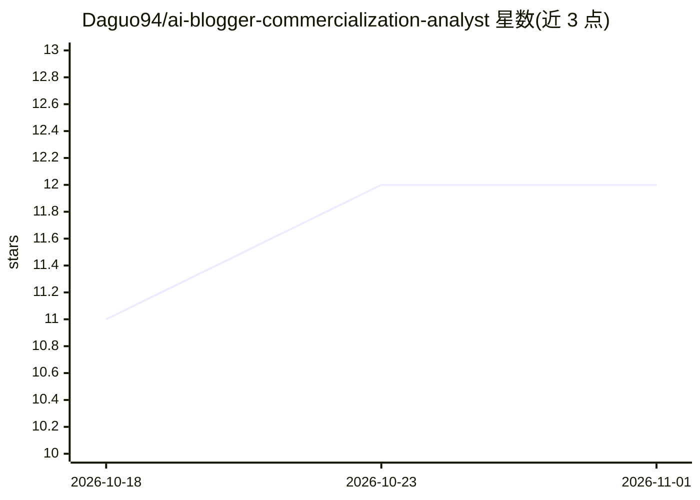

# Daguo94/ai-blogger-commercialization-analyst

⭐ 12 · MIT · 推送 2026-07-20 · [GitHub](https://github.com/Daguo94/ai-blogger-commercialization-analyst) · 个人维护 · 中文 README

**分析自媒体账号商业化潜力的 Codex Skill**

一个 Codex Skill（SKILL.md 格式）：在 Codex 中以命令调用，基于账号主页截图、内容样本、链接或运营数据，分析账号定位、内容策略、增长逻辑与商业化路径（广告、带货、课程、咨询、会员、版权与 IP）。设定分析原则：区分事实/推断/未知、不虚构数据、不混用统计口径。仓库含 SKILL.md、openai.yaml 与分析框架参考文档，以 git clone 后复制到 ~/.codex/skills 目录方式安装，MIT 许可。

## 筛选速览

| 维度 | 判定 | 备注 |
|---|---|---|
| AI 角色 | `ai-ecosystem` | LLM/agent 周边工具 |
| 许可风险 | `permissive` | MIT |
| 部署形态 | `None` |  |
| 模型依赖 | — | README 未给出锁定关系 |
| 硬件要求 | — | 无带数字的原话,不猜 |
| 安装摩擦 | `low` | 无编译、无系统依赖或容器化 |
| 成熟度 | — | 结构信号不足 |

## 能力要点

- 从截图、内容样本、链接或运营数据读取并生成账号商业分析
- 覆盖定位、增长逻辑、变现路径与合规风险等分析维度
- 分析原则要求区分事实/推断/未知，不虚构数据
- 提供分析框架参考文档（references/analysis-framework.md）

## 适用场景

- 分析 AI 类内容账号或知识博主的商业化潜力
- 对比多个竞品账号的复制门槛和变现能力
- 判断账号内容哪些值得借鉴、哪些不宜照搬

## 场景标签

`数据分析` · 领域:效率与自动化

## 证据(README 行号)

> L3: 一个用于拆解自媒体账号定位、内容策略、增长逻辑与商业化潜力的 Codex Skill。
> L33: ```text

## 星数曲线



2026-10-18 11 → 2026-11-01 12（+1）


---
*卡片 v1 · prompt 1.4 · 生成 2026-11-01 · 置信度 high · 依据 README sha `407a9a486080` · [字段定义](../../DATASET.md)*
