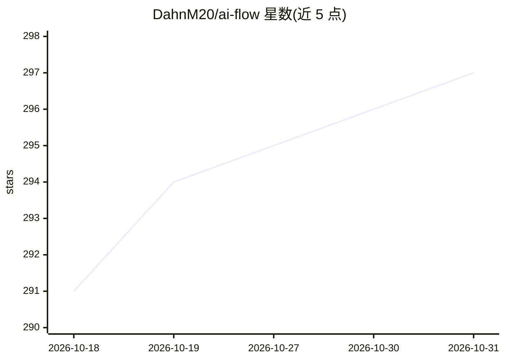

# DahnM20/ai-flow

⭐ 297 · TypeScript · MIT · 推送 2026-05-26 · [GitHub](https://github.com/DahnM20/ai-flow) · [官网](https://ai-flow.net/) · 个人维护

**拖拽式连接多家 AI 模型 API 构建可视化工作流的工具**

开源的可视化 AI 工作流工具：通过拖拽节点将 OpenAI、StabilityAI、Replicate、Claude、Deepseek、OpenRouter 等模型 API 连接为可复用的工作流，支持实时监控、节点并行、导入导出，用户使用自己的 API key。本地运行提供 Windows 可执行文件、Docker Compose 与源码（npm + poetry）三种方式。限制：完整功能需要自配 S3 兼容存储（CORS 设置）及 Replicate API key；另提供付费云版 AI-Flow Pro（子流程、API 触发、外部服务集成），开源版为 MIT 许可。

## 筛选速览

| 维度 | 判定 | 备注 |
|---|---|---|
| AI 角色 | `ai-ecosystem` | LLM/agent 周边工具 |
| 许可风险 | `permissive` | MIT |
| 部署形态 | `desktop` | 安装包/桌面程序 |
| 模型依赖 | locked-api |  |
| 硬件要求 | — | 无带数字的原话,不猜 |
| 安装摩擦 | `low` | 无编译、无系统依赖或容器化 |
| 成熟度 | — | 结构信号不足 |

## 能力要点

- 拖拽式节点编排连接多家模型 API，节点可并行执行
- 支持 Replicate 全量模型、OpenAI、StabilityAI、Claude、Deepseek、OpenRouter
- 工作流实时监控与导入/导出备份
- Windows 可执行文件 / Docker / 源码三种部署方式

## 适用场景

- 不会写代码，想用各家 AI API 搭建自己的处理流程
- 把文生图、文本、视频等多个模型串成一条可复用的流水线
- 在个人机器上用自有 API key 运行和管理工作流

## 场景标签

`工作流自动化` · 领域:效率与自动化

## 证据(README 行号)

> L25: **AI-Flow** is an open-source, user-friendly UI that lets you visually design, manage, and monitor AI-driven workfl
> L29: - **Visual Workflow Builder:** Drag-and-drop interface for crafting AI workflows.

## 星数曲线

2026-10-18 291 → 2026-10-31 297（+6）

---
*卡片 v1 · prompt 1.4 · 生成 2026-10-22 · 置信度 mid · 依据 README sha `a24691a151e6` · [字段定义](../../DATASET.md)*
