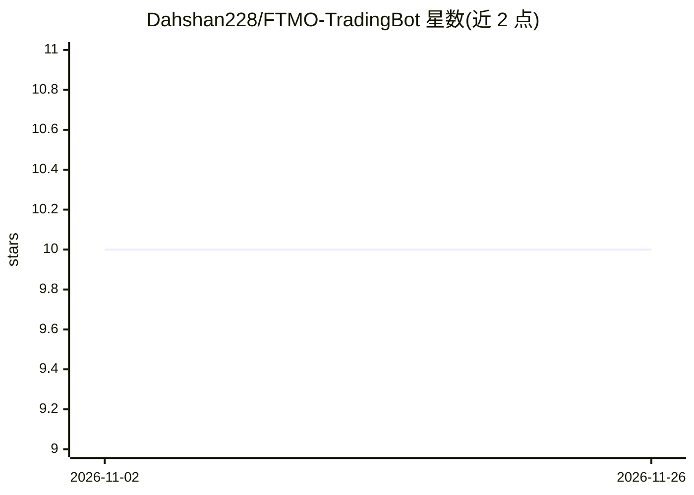

# Dahshan228/FTMO-TradingBot

⭐ 10 · Python · MIT · 推送 2026-07-11 · [GitHub](https://github.com/Dahshan228/FTMO-TradingBot) · 个人维护

**面向 FTMO MT5 账户的多策略算法交易机器人**

在共享 FTMO MT5 账户上并排运行三个独立机器人：基于 LightGBM 三分类美股信号的股票机器人、BTC 与外汇黄金交叉趋势跟踪机器人，内置 FTMO 合规模块（5%/10% 回撤限制、8-10% 滞纳规则、30 天不活跃规则）、四层风控、跨机器人共识仓位调整与 Streamlit 仪表盘。提供 2015-2025 回测数据，实盘仅在 demo 账户验证；实盘交易要求 Windows（MetaTrader5 SDK 仅支持 Windows），回测与训练跨平台。

## 筛选速览

| 维度 | 判定 | 备注 |
|---|---|---|
| AI 角色 | `ai-native` | 本体是模型或模型工具 |
| 许可风险 | `permissive` | MIT |
| 部署形态 | `library` | 以包/库形式分发 |
| 模型依赖 | — | README 未给出锁定关系 |
| 硬件要求 | — | 无带数字的原话,不猜 |
| 安装摩擦 | `low` | 无编译、无系统依赖或容器化 |
| 成熟度 | — | 结构信号不足 |

## 能力要点

- LightGBM 三分类模型生成美股信号，13 折 walk-forward 验证
- 三个机器人共享账户并独立执行 FTMO 亏损限制与 75% 组合敞口上限
- 回撤滞纳与不活跃追踪器，Discord 告警
- 跨平台回测/训练，实盘仅限 Windows

## 适用场景

- 在 FTMO 自营账户上运行多策略交易机器人
- 回测与训练美股/外汇/BTC 交易策略
- 通过仪表盘监控账户回撤与 FTMO 合规状态

## 场景标签

`金融量化` · 领域:学习与行业

## 证据(README 行号)

> L7: Multi-strategy algorithmic trading bot for FTMO MT5 prop accounts. Three independent bots run side-by-side on a shar
> L11: |Equity|LightGBM 3-class on `^GSPC` daily bars|US500 (CFD)|Full Kelly capped at 30%|

## 星数曲线

2026-11-02 10 → 2026-11-26 10（+0）

---
*卡片 v1 · prompt 1.4 · 生成 2026-11-20 · 置信度 high · 依据 README sha `39473c9be50e` · [字段定义](../../DATASET.md)*
