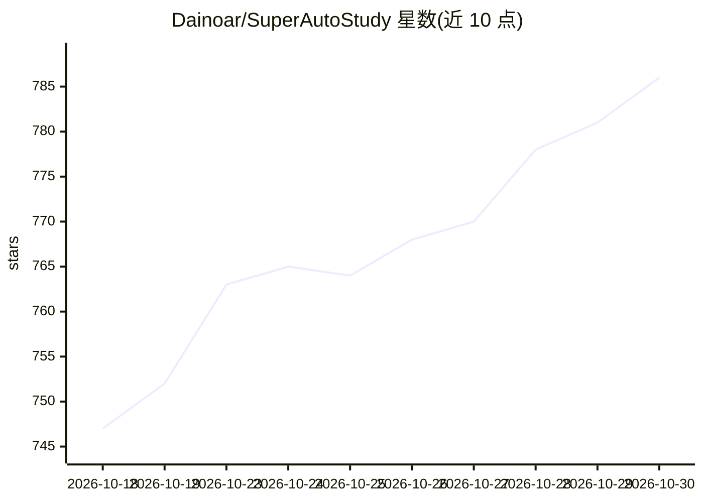

# Dainoar/SuperAutoStudy

⭐ 786 · Java · Apache-2.0 · 推送 2026-07-14 · [GitHub](https://github.com/Dainoar/SuperAutoStudy) · 个人维护 · 中文 README

**学习通课程任务自动化平台：自动刷课与自动答题**

基于 Spring Boot + Dubbo + RabbitMQ + Redis 的分布式学习通任务自动化工具，通过模拟真实用户行为自动播放视频、同步进度并完成章节测验；答题环节接入百万级 Super 题库并支持大模型答题。功能上支持断点续学、高并发任务调度，提供 Docker Compose 一键部署（ARM/x86）与轻量版预编译 JAR。README 声明仅供技术研究，要求遵守院校学术规范；考试系统模块为开发中状态。

## 筛选速览

| 维度 | 判定 | 备注 |
|---|---|---|
| AI 角色 | `ai-enhanced` | 去掉 AI 部分产品仍成立 |
| 许可风险 | `permissive` | Apache-2.0 |
| 部署形态 | `self-host` | docker 或自建部署 |
| 模型依赖 | — | README 未给出锁定关系 |
| 硬件要求 | — | 无带数字的原话,不猜 |
| 安装摩擦 | `low` | 无编译、无系统依赖或容器化 |
| 成熟度 | — | 结构信号不足 |

## 能力要点

- 基于学习通官方 API 模拟真实用户操作
- Super 题库（百万级）+ 大模型自动答题
- Dubbo/RabbitMQ/Redis 微服务架构与断点续学
- Docker Compose 一键部署，支持 ARM/x86

## 适用场景

- 自部署自动化完成学习通视频学习任务
- 章节测验自动匹配题库并提交答案
- 个人部署或基于源码二次开发

## 场景标签

`工作流自动化` · 领域:效率与自动化

## 证据(README 行号)

> L9: > 基于 Spring Boot + Dubbo + RabbitMQ 的分布式学习任务自动化平台，支持视频学习、章节测验等核心功能。
> L21: - **智能答题**：集成自研 Super 题库（百万级），支持自动匹配与提交。
> L34: |章节测验|✅ 已支持|接入 Super 题库，支持自动答题|

## 星数曲线

2026-10-18 747 → 2026-10-30 786（+39）

---
*卡片 v1 · prompt 1.4 · 生成 2026-10-23 · 置信度 high · 依据 README sha `6556e4035a8c` · [字段定义](../../DATASET.md)*
