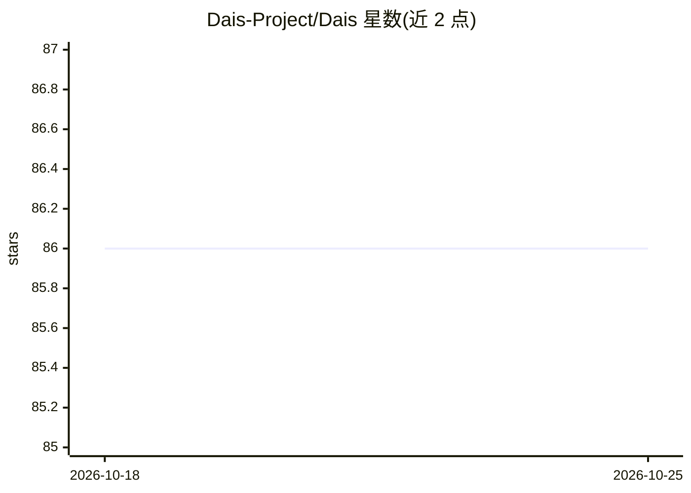

# Dais-Project/Dais

⭐ 86 · TypeScript · 推送 2026-10-24 · [GitHub](https://github.com/Dais-Project/Dais) · 组织维护 · 中文 README

**桌面多 Agent AI 员工应用：管理技能与工作区并行处理任务**

Dais 是一款桌面端多 Agent 应用，定位为'桌面 AI 员工'。功能包括：MCP 协议支持以接入外部工具、技能集中管理与分配、多工作区切换、并行任务处理、通过子任务分派实现多 Agent 协作。面向需要本地多 Agent 桌面工作流的用户，以 GitHub Releases 下载安装包使用；开发需 uv、pnpm、node、rustup 等前置工具链，用 pnpm 安装依赖并启动开发服务器。README 未提供具体模型接入细节的进一步说明。

## 筛选速览

| 维度 | 判定 | 备注 |
|---|---|---|
| AI 角色 | `ai-native` | 本体是模型或模型工具 |
| 许可风险 | `none` | — |
| 部署形态 | `library` | 以包/库形式分发 |
| 模型依赖 | — | README 未给出锁定关系 |
| 硬件要求 | — | 无带数字的原话,不猜 |
| 安装摩擦 | `low` | 无编译、无系统依赖或容器化 |
| 成熟度 | — | 结构信号不足 |

## 能力要点

- MCP 支持接入外部工具扩展 Agent 任务范围
- 技能集中管理与按任务分配
- 多工作区切换与并行任务处理
- 通过子任务分派进行多 Agent 协作

## 适用场景

- 在桌面同时运行多个 AI Agent 处理并行任务
- 通过 MCP 扩展 Agent 的外部工具能力
- 按项目切换工作区组织不同任务场景

## 场景标签

`多智能体` `AI 助手` · 领域:Agent 开发

## 证据(README 行号)

> L3:  Your D esktop AI S taffs
> L20: - MCP support: Connect more external tools so Agents can handle a wider range of task scenarios

## 星数曲线

2026-10-18 86 → 2026-10-25 86（+0）

---
*卡片 v1 · prompt 1.4 · 生成 2026-10-24 · 置信度 low · 依据 README sha `48b1a3f5880c` · [字段定义](../../DATASET.md)*
