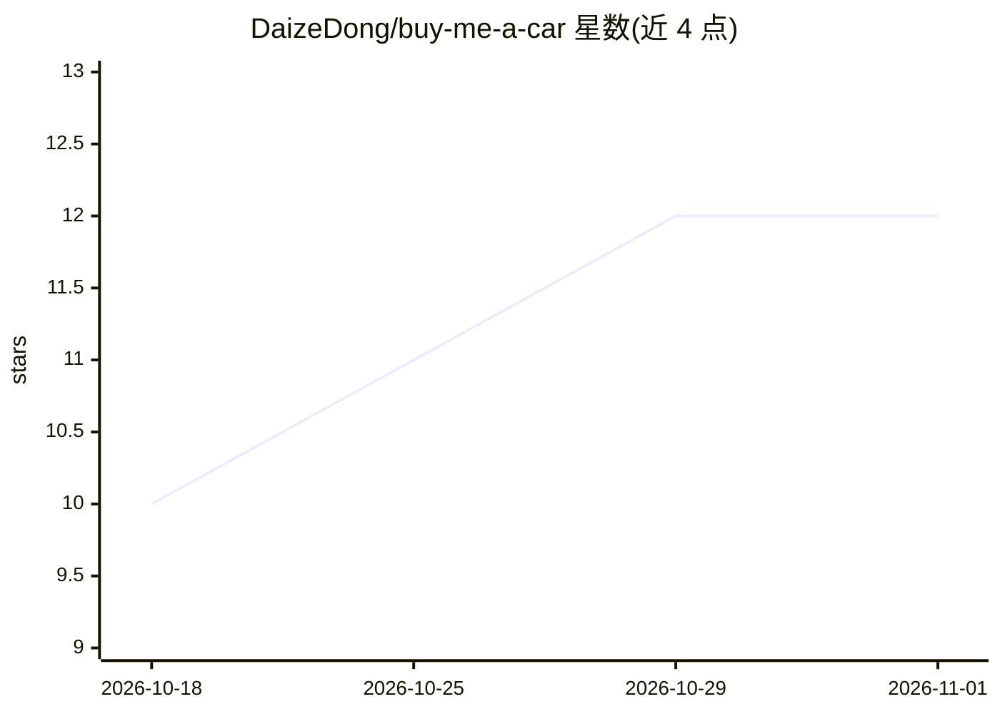

# DaizeDong/buy-me-a-car

⭐ 12 · Python · MIT · 推送 2026-10-16 · [GitHub](https://github.com/DaizeDong/buy-me-a-car) · [官网](https://github.com/DaizeDong/buy-me-a-car) · 个人维护 · 中文 README

**面向 Claude 类 agent 的 16 项美国购车研究技能包**

Claude Code Skill 形式的 agent 技能包：一个编排技能加 15 个专项技能，覆盖美国购车全流程，包括 OTD 落地价计算、州税费查询、CARFAX 报告审阅、置换估值、租赁对比、经销商还价草稿、收件箱分诊与买家报告 HTML/PDF 生成。依赖宿主提供的搜索、浏览器与邮箱工具，不自带调度或预订服务；真实数据存放在买家私有 Git 伴随仓库，安装需 Python 3.10+、Git 及 fleet-guards/fleet-style 检出，PDF 渲染用 Chromium 或 Edge。当前研究渲染器输出中文报告。

## 筛选速览

| 维度 | 判定 | 备注 |
|---|---|---|
| AI 角色 | `ai-ecosystem` | LLM/agent 周边工具 |
| 许可风险 | `permissive` | MIT |
| 部署形态 | `None` |  |
| 模型依赖 | locked-api |  |
| 硬件要求 | — | 无带数字的原话,不猜 |
| 安装摩擦 | `low` | 无编译、无系统依赖或容器化 |
| 成熟度 | — | 结构信号不足 |

## 能力要点

- 1 个编排技能 + 15 个专项技能覆盖购车全流程
- OTD 落地价逐项计算与州税费规则核验
- 证据可溯源：保留来源日期、原始工件与缺口
- 私有伴随 Git 仓库存储真实需求、报价与报告

## 适用场景

- 让 Claude 类 agent 规划从需求到成交的美国购车流程
- 计算与核验 OTD 落地价、州税费与置换估值
- 审阅 CARFAX 车辆历史报告并生成买家研究 HTML/PDF 报告
- 起草授权范围内的经销商还价邮件并分诊回复

## 场景标签

 · 领域:汽车/消费决策工具

## 证据(README 行号)

> L3: Research a US car purchase with 16 skills, from the first request to a compared shortlist, buyer report and closing 
> L29: This is an agent skill package. It uses search, browser and mailbox tools supplied by the host; it does not install
> L54: The installer previews first, then `--apply` registers all 16 skills under `~/.agents/skills`. Use `--target <skill

## 星数曲线

2026-10-18 10 → 2026-11-01 12（+2）

---
*卡片 v1 · prompt 1.4 · 生成 2026-11-01 · 置信度 high · 依据 README sha `5f3df746e7c2` · [字段定义](../../DATASET.md)*
