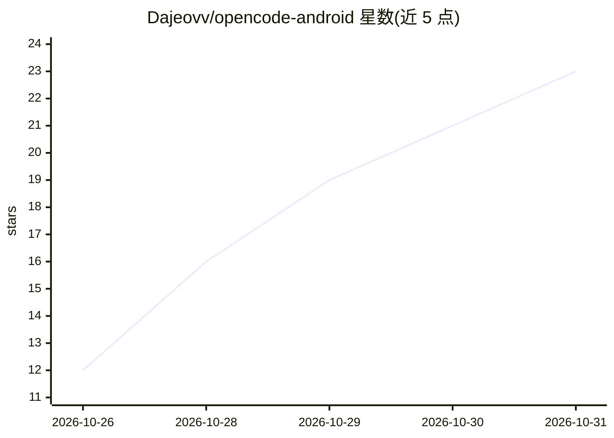

# Dajeovv/opencode-android

⭐ 23 · Java · MIT · 推送 2026-10-30 · [GitHub](https://github.com/Dajeovv/opencode-android) · [官网](https://github.com/Dajeovv/opencode-android/releases/latest) · 个人维护

**在 Android 手机本地原生运行 opencode 编码 agent 的非官方客户端**

opencode 的非官方 Android 客户端：将 opencode 1.19.4 以原生 ARM64 进程内嵌于单个 APK，无需 Termux、PC 或 root。APK 内置 git、python3、node、ssh、make 等工具链与真实的 apt/dpkg/pkg 包管理，可按需安装 clang、rust、go 等；通过 Termux:API 兼容命令向 agent 暴露电池、剪贴板、传感器等手机能力，并支持无线 ADB 控制 App。默认使用 opencode.ai 免费模型，可在设置中连接其他 provider。首次运行需联网下载约 200 MB 依赖；已在单一 Android 15 arm64 设备上验证，Android 8-14 未测试。

## 筛选速览

| 维度 | 判定 | 备注 |
|---|---|---|
| AI 角色 | `ai-native` | 本体是模型或模型工具 |
| 许可风险 | `permissive` | MIT |
| 部署形态 | `None` |  |
| 模型依赖 | — | README 未给出锁定关系 |
| 硬件要求 | — | 无带数字的原话,不猜 |
| 安装摩擦 | `medium` | 含编译或系统依赖之一 |
| 成熟度 | — | 结构信号不足 |

## 能力要点

- opencode 1.19.4 以原生 ARM64 进程运行，内嵌于单个 APK
- 内置 git/python3/node/ssh 等完整工具链与 apt/dpkg/pkg 包管理
- Termux:API 兼容命令暴露电池、剪贴板、Wi-Fi、传感器等手机能力
- opencode 与应用自身支持从 GitHub Releases 自更新，失败自动回滚

## 适用场景

- 在手机上本地运行编码 agent 编辑文件、执行命令
- 通过无线 ADB 让 agent 控制手机上的应用与界面
- 在对话中直接 pkg install 安装 clang/rust/go 等扩展工具链

## 场景标签

`编码 Agent` `GUI 自动化` · 领域:效率与自动化

## 证据(README 行号)

> L25: opencode is a real coding agent, not just a chatbot. It can inspect and edit files, run commands, and — with wirele
> L44: - **Native ARM64 runtime.** opencode 1.19.4 is embedded in the APK and runs as a native process. No Termux, no root

## 星数曲线

2026-10-26 12 → 2026-10-31 23（+11）

---
*卡片 v1 · prompt 1.4 · 生成 2026-10-29 · 置信度 high · 依据 README sha `7cb65075bb74` · [字段定义](../../DATASET.md)*
