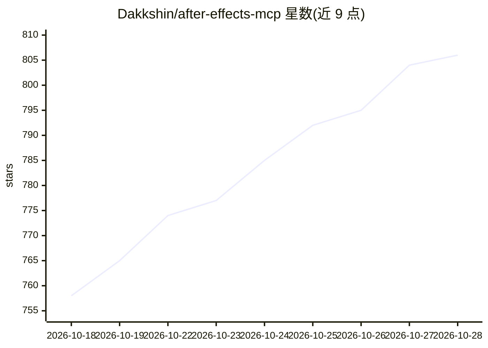

# Dakkshin/after-effects-mcp

⭐ 806 · JavaScript · MIT · 推送 2026-04-01 · [GitHub](https://github.com/Dakkshin/after-effects-mcp) · 个人维护

**让 AI 助手通过 MCP 协议远程控制 After Effects 的服务器**

基于 Node.js/TypeScript 的 MCP 服务器，通过 ExtendScript 桥接面板（mcp-bridge-auto.jsx）与 After Effects 通信，使 AI 助手或自定义应用能创建合成、文本/形状/纯色/摄像机图层、修改属性、设置关键帧与表达式。安装流程为克隆仓库、npm 安装依赖、构建并向 AE 安装面板，随后在 Claude 或 Cursor 等 MCP 客户端中配置。要求 After Effects 2022 及以上和 Node.js v14 及以上。

## 筛选速览

| 维度 | 判定 | 备注 |
|---|---|---|
| AI 角色 | `ai-ecosystem` | LLM/agent 周边工具 |
| 许可风险 | `permissive` | MIT |
| 部署形态 | `library` | 以包/库形式分发 |
| 模型依赖 | — | README 未给出锁定关系 |
| 硬件要求 | — | 无带数字的原话,不猜 |
| 安装摩擦 | `low` | 无编译、无系统依赖或容器化 |
| 成熟度 | — | 结构信号不足 |

## 能力要点

- MCP 协议标准化控制 After Effects 合成、图层与属性
- 支持关键帧、表达式与批量属性设置的动画能力
- 提供 run-script 等十余个 MCP 工具接口
- 通过 ExtendScript 桥接面板实现命令轮询执行

## 适用场景

- 让 Claude/Cursor 等 AI 客户端代为操作 After Effects 合成与图层
- 自动化批量的动效属性设置与关键帧生成
- 在脚本化工作流中以 MCP 工具驱动 AE

## 场景标签

`工作流自动化` · 领域:效率与自动化

## 证据(README 行号)

> L8: ✨ A Model Context Protocol (MCP) server for Adobe After Effects that enables AI assistants and other applications to
> L119: Once you have the server running and the MCP Bridge panel open in After Effects, you can control After Effects thr

## 星数曲线

2026-10-18 758 → 2026-10-28 806（+48）

---
*卡片 v1 · prompt 1.4 · 生成 2026-10-21 · 置信度 high · 依据 README sha `afc2bf028278` · [字段定义](../../DATASET.md)*
