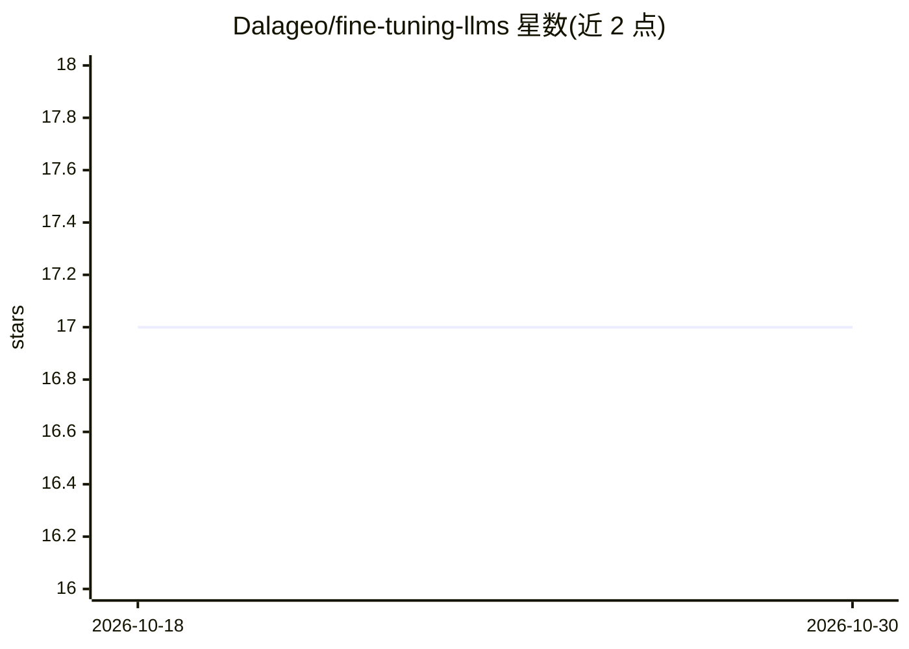

# Dalageo/fine-tuning-llms

⭐ 17 · Python · AGPL-3.0 · 推送 2026-04-23 · [GitHub](https://github.com/Dalageo/fine-tuning-llms) · 个人维护

**面向开发者的 LLM 低资源微调实现：LoRA/QLoRA + Unsloth/HF 双路径**

在消费级 GPU 上微调大语言模型的模块化代码库：以 Hugging Face 库与 Unsloth 框架两条训练路径实现 PEFT，支持 LoRA 与 4-bit 量化的 QLoRA，QLoRA 模式经 Unsloth 优化内核加速训练并降低 VRAM 占用。以 Gemma-3-1B-IT 为基础模型，在心理健康情绪分析数据集（约 5.3 万行、7 类、类别不均衡）上演示完整流程：Poetry 安装依赖、配置训练模式、训练后可运行评估/对话推理并上传 HuggingFace Hub。要求 Linux/WSL2 环境、CUDA 12.4 的 NVIDIA GPU。

## 筛选速览

| 维度 | 判定 | 备注 |
|---|---|---|
| AI 角色 | `ai-ecosystem` | LLM/agent 周边工具 |
| 许可风险 | `viral` | AGPL-3.0 |
| 部署形态 | `None` |  |
| 模型依赖 | — | README 未给出锁定关系 |
| 硬件要求 | — | 无带数字的原话,不猜 |
| 安装摩擦 | `medium` | 含编译或系统依赖之一 |
| 成熟度 | — | 结构信号不足 |

## 能力要点

- Hugging Face 与 Unsloth 两条可切换的训练路径
- LoRA 与 4-bit QLoRA 两种微调模式
- 训练产物含 adapter 权重、tokenizer、检查点，可一键上传 HuggingFace Hub
- 提供 eval 与 chat 两种推理模式

## 适用场景

- 在个人 GPU 上微调十亿参数级模型用于下游任务
- 复现心理健康文本情绪分类的微调实验
- 参考代码结构将 LoRA/QLoRA 流程迁移到自己的数据集

## 场景标签

`微调` · 领域:训练与推理

## 证据(README 行号)

> L13: This project implements a resource-efficient method for fine-tuning Large Language Models (LLMs) on consumer-grade 
> L15: The key to achieving this resource-efficient method lies in the use of **Low-Rank Adaptation (LoRA)**. Instead of r

## 星数曲线

2026-10-18 17 → 2026-10-30 17（+0）

---
*卡片 v1 · prompt 1.4 · 生成 2026-10-30 · 置信度 high · 依据 README sha `7a7df48566a8` · [字段定义](../../DATASET.md)*
