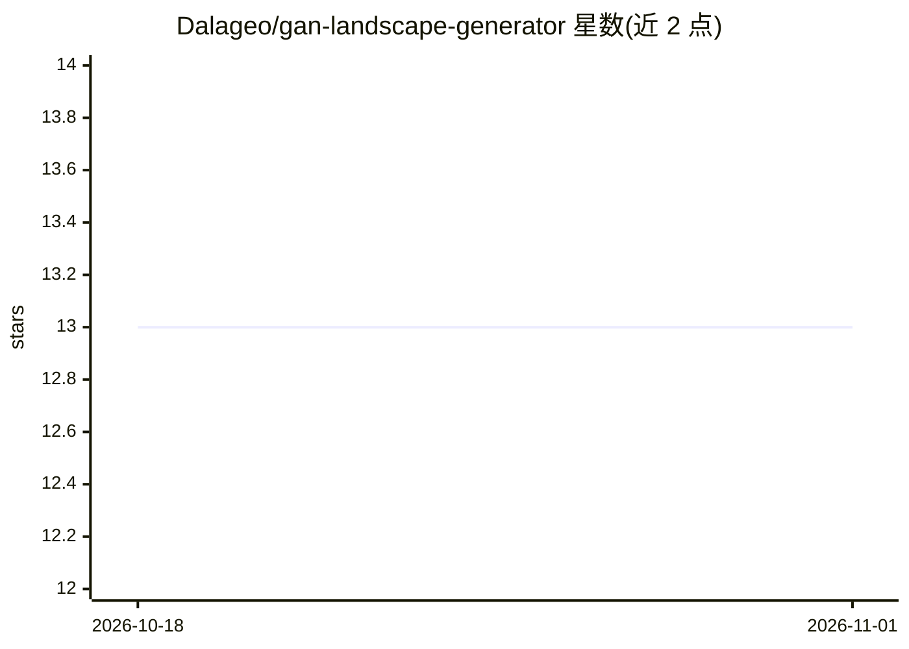

# Dalageo/gan-landscape-generator

⭐ 13 · Jupyter Notebook · AGPL-3.0 · 推送 2026-04-23 · [GitHub](https://github.com/Dalageo/gan-landscape-generator) · 个人维护

**用 DCGAN 与 StyleGAN3 生成风景图像的项目（含模型微调）**

探索图像生成模型的实验项目：先尝试训练 DCGAN 生成风景图，后改用 NVIDIA 提供、Justin Pinkney 在 1500 万张风景图上微调的 StyleGAN3-t LHQ 256 预训练模型，并在 Landscape Pictures 数据集（4,300 张 Flickr 风景照，统一缩放到 256x256）上进一步微调 50 epochs。项目以 Jupyter Notebook（DCGAN）和 Python 脚本（StyleGAN3）形式提供，需自行配置 Python 3.9.20、PyTorch 2.5.1、CUDA 11.8 环境并指定数据/模型/输出路径，GPU 训练需自行启用支持。许可混合：代码 AGPL-3.0、微调模型 Nvidia Source Code License、数据集 CC 1.0。

## 筛选速览

| 维度 | 判定 | 备注 |
|---|---|---|
| AI 角色 | `ai-native` | 本体是模型或模型工具 |
| 许可风险 | `viral` | AGPL-3.0 |
| 部署形态 | `None` |  |
| 模型依赖 | — | README 未给出锁定关系 |
| 硬件要求 | — | 无带数字的原话,不猜 |
| 安装摩擦 | `medium` | 含编译或系统依赖之一 |
| 成熟度 | — | 结构信号不足 |

## 能力要点

- 提供 DCGAN 架构训练与生成风景图像
- 使用 StyleGAN3-t LHQ 256 预训练模型并在 4,300 张风景图上微调 50 epochs
- 基于 Flickr 的 Landscape Pictures 数据集，含 7 类风景类别
- 以 Jupyter Notebook 与 Python 脚本复现训练与生成流程

## 适用场景

- 我想复现风景图像的 GAN 训练与生成实验
- 我想在小型自有风景数据集上微调 StyleGAN3
- 我想对比 DCGAN 与预训练 StyleGAN3 的生成效果

## 场景标签

`图像生成` `微调` · 领域:内容生成

## 证据(README 行号)

> L15: # Generating Landscapes Using DCGAN and StyleGAN3 🏞️
> L17: This project examines image generative models, focusing on DCGAN and StyleGAN3. Initially, the project started by t

## 星数曲线

2026-10-18 13 → 2026-11-01 13（+0）

---
*卡片 v1 · prompt 1.4 · 生成 2026-10-31 · 置信度 high · 依据 README sha `a0201224b3d5` · [字段定义](../../DATASET.md)*
