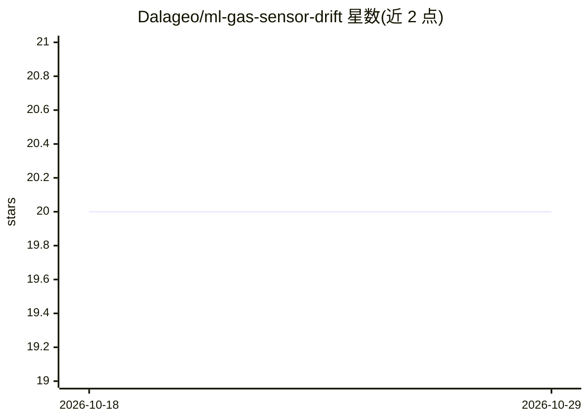

# Dalageo/ml-gas-sensor-drift

⭐ 20 · Jupyter Notebook · AGPL-3.0 · 推送 2026-04-23 · [GitHub](https://github.com/Dalageo/ml-gas-sensor-drift) · 个人维护

**基于 UCI 气体传感器数据集的传感器漂移检测回归项目**

分析 16 个化学传感器在 6 种气体、不同浓度下为期 36 个月的漂移情况：使用 UCI Gas Sensor Array Drift 数据集（13,910 条测量、128 维特征），训练 Decision Tree、Random Forest 与 XGBoost 三种回归模型预测 5-1000 ppmv 浓度值，按气体分布分三组建模，用 Optuna 调参。前 6 个批次作为校准期训练，后续批次（7-10）评估漂移影响。以 Jupyter notebook 形式提供，克隆仓库即含数据集。

## 筛选速览

| 维度 | 判定 | 备注 |
|---|---|---|
| AI 角色 | `ai-native` | 本体是模型或模型工具 |
| 许可风险 | `viral` | AGPL-3.0 |
| 部署形态 | `None` |  |
| 模型依赖 | — | README 未给出锁定关系 |
| 硬件要求 | — | 无带数字的原话,不猜 |
| 安装摩擦 | `medium` | 含编译或系统依赖之一 |
| 成熟度 | — | 结构信号不足 |

## 能力要点

- 三种回归模型（Decision Tree/Random Forest/XGBoost）预测气体浓度
- 按气体分布分三组分别建模与调参
- 用批次 7-10 评估传感器漂移对模型精度的影响
- 数据集随仓库附带，无需单独下载

## 适用场景

- 复现气体传感器漂移检测的建模分析流程
- 了解传感器漂移如何随时间影响回归模型精度
- 学习化学传感器数据的特征结构与回归建模方法

## 场景标签

 · 领域:传感器数据科学/机器学习

## 证据(README 行号)

> L17: This project focuses on analyzing the performance of 16 chemical sensors exposed to six different gases at varying 
> L25: The dataset used in this project is the Gas Sensor Array Drift at Different Concentrations from the UCI Machine Lea

## 星数曲线

2026-10-18 20 → 2026-10-29 20（+0）

---
*卡片 v1 · prompt 1.4 · 生成 2026-10-28 · 置信度 high · 依据 README sha `4678acd76bf7` · [字段定义](../../DATASET.md)*
