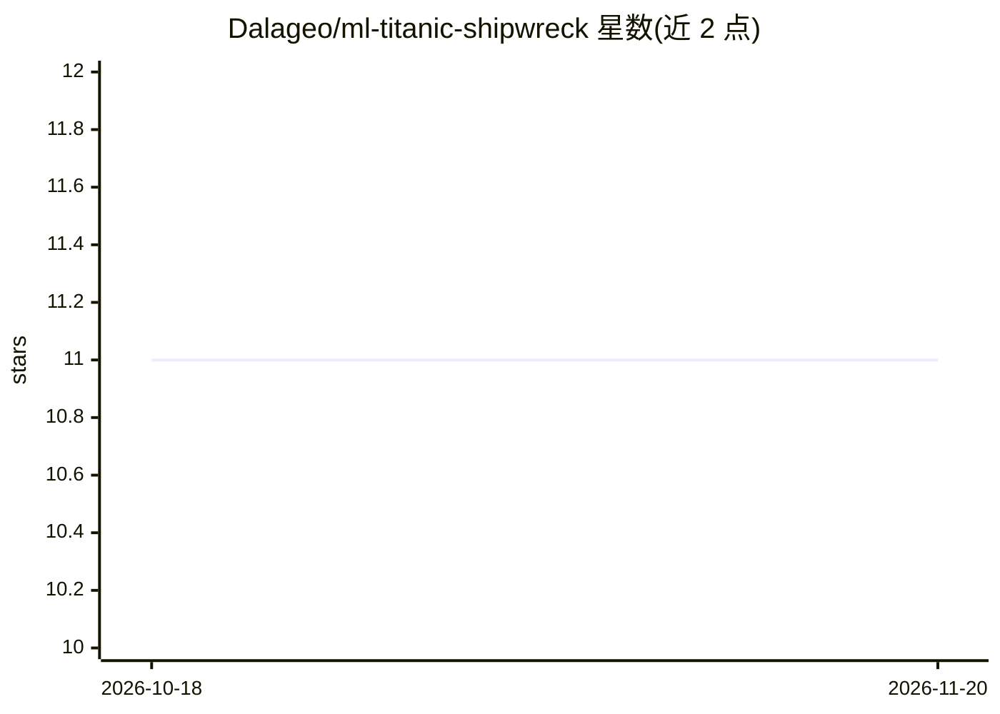

# Dalageo/ml-titanic-shipwreck

⭐ 11 · Jupyter Notebook · Apache-2.0 · 推送 2026-04-23 · [GitHub](https://github.com/Dalageo/ml-titanic-shipwreck) · 个人维护

**基于 Titanic 数据集的生存预测建模教程型项目**

探索 Titanic 乘客数据中影响生存的因素，并构建生存概率预测模型。项目比较两种缺失值处理方式（删除 vs 填充），使用逻辑回归、决策树、随机森林、XGBoost 及 stacking 集成等方法，以 Kaggle Titanic 竞赛成绩（前 9.38%）作为验证。提供 Google Colab 与本地 Jupyter 两种运行路径，需从 Kaggle 下载 train.csv/test.csv 并在笔记本中配置文件路径。

## 筛选速览

| 维度 | 判定 | 备注 |
|---|---|---|
| AI 角色 | `ai-knowledge` | 知识聚合/清单类 |
| 许可风险 | `permissive` | Apache-2.0 |
| 部署形态 | `None` |  |
| 模型依赖 | — | README 未给出锁定关系 |
| 硬件要求 | — | 无带数字的原话,不猜 |
| 安装摩擦 | `low` | 无编译、无系统依赖或容器化 |
| 成熟度 | — | 结构信号不足 |

## 能力要点

- 比较删除与填充两种缺失数据处理策略对模型效果的影响
- 使用 scikit-learn、XGBoost 等实现多种分类器与 stacking 集成
- 提供 Colab 在线运行与本地克隆两种复现路径
- 模型提交 Kaggle 竞赛并进入前 9.38%

## 适用场景

- 学习在真实数据集上做缺失值处理与分类建模
- 复现并实验 Kaggle Titanic 竞赛的预测流程
- 对比多种集成学习方法的实现

## 场景标签

`教程课程` · 领域:学习与行业

## 证据(README 行号)

> L15: This repository explores the factors affecting passenger survival on the Titanic and aims to build a predictive mod
> L17: In this project, two different approaches are explored and compared based on model performance:
> L23: Overall, more robust models (Random Forest, XGBoost) were achieved using the second approach, which involved fillin

## 星数曲线

2026-10-18 11 → 2026-11-20 11（+0）

---
*卡片 v1 · prompt 1.4 · 生成 2026-11-19 · 置信度 high · 依据 README sha `34baabefb2f1` · [字段定义](../../DATASET.md)*
