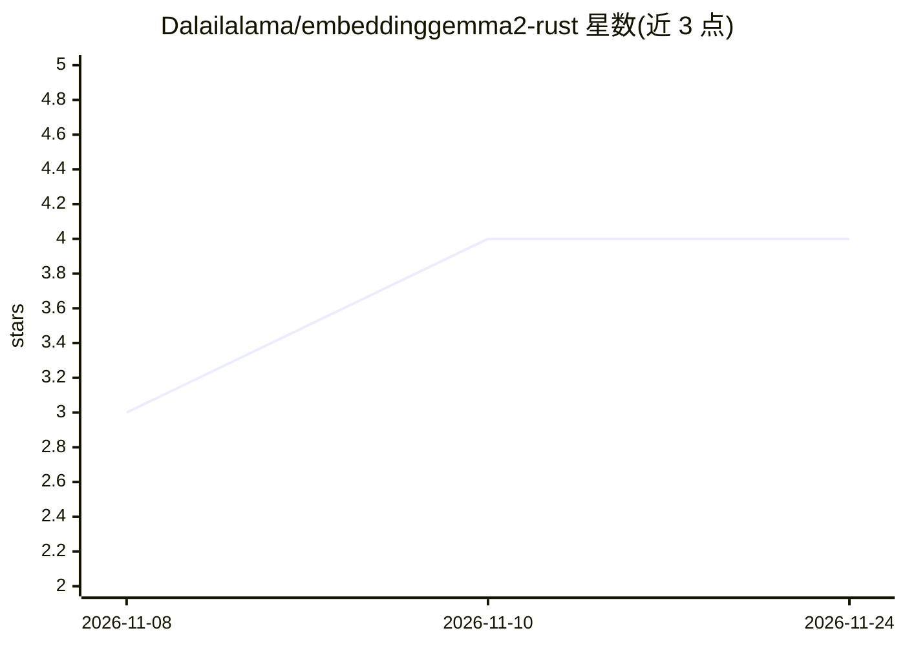

# Dalailalama/embeddinggemma2-rust

⭐ 4 · Rust · Apache-2.0 · 推送 2026-10-22 · [GitHub](https://github.com/Dalailalama/embeddinggemma2-rust) · [官网](https://huggingface.co/DawgOG/embeddinggemma2-rust) · 个人维护

**Rust 实现的 EmbeddingGemma 2 多模态嵌入库与服务器**

Google embeddinggemma-2 的从零 Rust 移植：将文本、图像、音频、视频嵌入到统一的 768 维空间，支持 Matryoshka 截断到 512/256/128 维。CPU 以 fp32 运行，NVIDIA GPU 经 CUDA 支持 fp32/TF32/bf16（cuBLAS 与运行时编译内核，含张量核 flash attention），运行时无需 Python 或 PyTorch。`egemma2 serve` 提供JSON-lines 与 OpenAI 兼容 HTTP 接口；与 PyTorch 参考实现做 92 项数值对齐校验。安装途径包括 pip 预编译包、Releases 二进制与 cargo 源码构建。

## 筛选速览

| 维度 | 判定 | 备注 |
|---|---|---|
| AI 角色 | `ai-native` | 本体是模型或模型工具 |
| 许可风险 | `permissive` | Apache-2.0 |
| 部署形态 | `desktop` | 安装包/桌面程序 |
| 模型依赖 | — | README 未给出锁定关系 |
| 硬件要求 | — | 无带数字的原话,不猜 |
| 安装摩擦 | `high` | 编译与系统依赖俱全 |
| 成熟度 | — | 结构信号不足 |

## 能力要点

- 文本/图像/音频/视频统一嵌入 768 维空间，Matryoshka 截断至 512/256/128
- CPU fp32 与 CUDA fp32/TF32/bf16 后端，CUDA 库运行时动态加载，无需 CUDA SDK
- 与 Hugging Face 参考实现逐数对齐，92 项校验覆盖文本/图像/音频/视频
- JSON-lines 与 OpenAI 兼容 HTTP 服务器模式

## 适用场景

- 为 RAG 系统生成文档与查询的多模态嵌入
- 在无 Python 环境中运行嵌入模型
- 批量索引 PDF 页面图像等大规模媒体嵌入
- 通过 OpenAI 兼容接口向任意语言的应用提供嵌入服务

## 场景标签

`语义搜索` `多模态` · 领域:知识与检索

## 证据(README 行号)

> L8: A from-scratch Rust port of `google/embeddinggemma-2`
> L10: text, images, audio and video embedded into one 768-d space, with Matryoshka truncation to
> L14: loaded behind a JSON-lines or OpenAI-compatible HTTP interface for applications in any language.

## 星数曲线

2026-11-08 3 → 2026-11-24 4（+1）

---
*卡片 v1 · prompt 1.4 · 生成 2026-11-21 · 置信度 high · 依据 README sha `601fd08024fd` · [字段定义](../../DATASET.md)*
