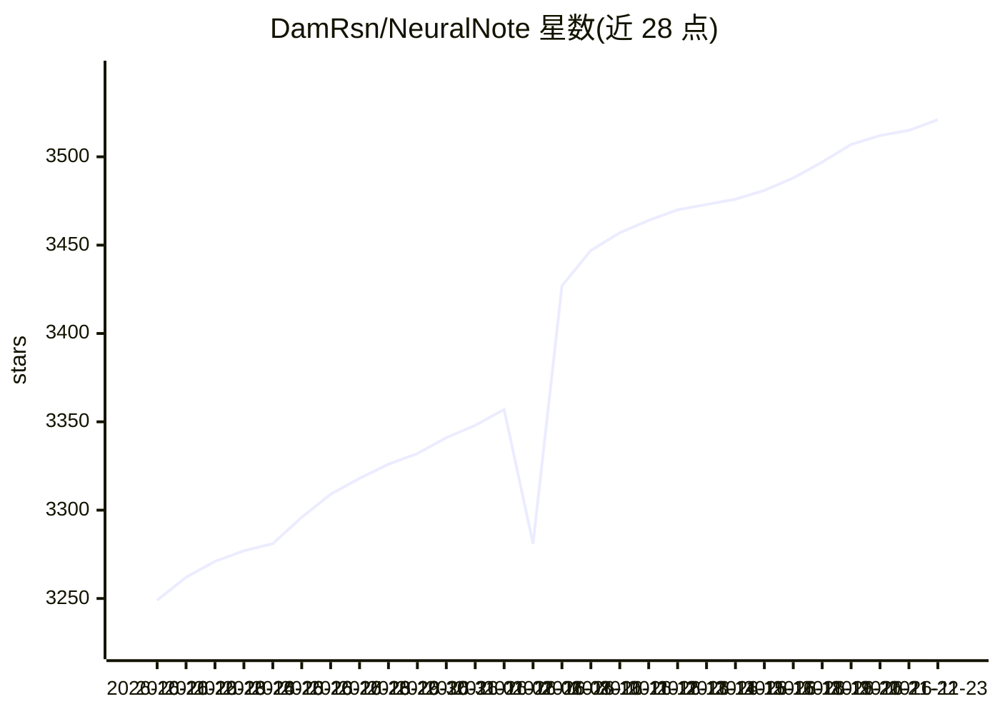

# DamRsn/NeuralNote

⭐ 3,521 · C++ · Apache-2.0 · 推送 2026-11-07 · [GitHub](https://github.com/DamRsn/NeuralNote) · [官网](https://neuralnote.co/) · 个人维护

**音乐人/制作人的 DAW 内音频转 MIDI 插件**

运行于 DAW 内的 AudioFX 插件（VST3/AU/Standalone），使用 MuScriptor 模型（103M–1.4B 参数 transformer）将音频转录为多乐器 MIDI，音符按乐器分组并内置合成器回放。转录完全本地运行，GPU 经 Metal/Vulkan、CPU 亦可。支持现场录音或拖入音频文件、后台转录可暂停续跑、拖放 MIDI 到音轨。模型以 GGUF 形式从 Hugging Face 下载（约 210 MB–2.7 GB），首次启动需在应用内下载模型。

## 筛选速览

| 维度 | 判定 | 备注 |
|---|---|---|
| AI 角色 | `ai-native` | 本体是模型或模型工具 |
| 许可风险 | `permissive` | Apache-2.0 |
| 部署形态 | `desktop` | 安装包/桌面程序 |
| 模型依赖 | — | README 未给出锁定关系 |
| 硬件要求 | — | 无带数字的原话,不猜 |
| 安装摩擦 | `medium` | 含编译或系统依赖之一 |
| 成熟度 | — | 结构信号不足 |

## 能力要点

- 多乐器音频转录，音符按乐器分组，内置多乐器合成器
- 完全本地推理，支持 Metal/Vulkan GPU 与 CPU
- 转录后台运行、可暂停恢复，结果可拖放导出 MIDI
- 提供 small/medium/large 三档模型，按速度与质量取舍

## 适用场景

- 把录音或音频文件转成 MIDI 在 DAW 里编辑
- 对整轨混音做分乐器的 MIDI 抄谱
- DAW 内实时录制演奏并即时转录为 MIDI

## 场景标签

 · 领域:音频/音乐制作工具

## 证据(README 行号)

> L3: NeuralNote is the audio plugin that brings **state-of-the-art audio-to-MIDI transcription** into your favorite Digit
> L14: - **A new, much more capable transcription model.** v2 replaces Spotify's Basic Pitch with
> L24: - **Still fully local.** Transcription runs on your machine, on the GPU or the CPU, and your audio never leaves it.

## 星数曲线

2026-10-21 3,249 → 2026-11-23 3,521（+272）

---
*卡片 v1 · prompt 1.4 · 生成 2026-11-23 · 置信度 high · 依据 README sha `429dd08244c3` · [字段定义](../../DATASET.md)*
