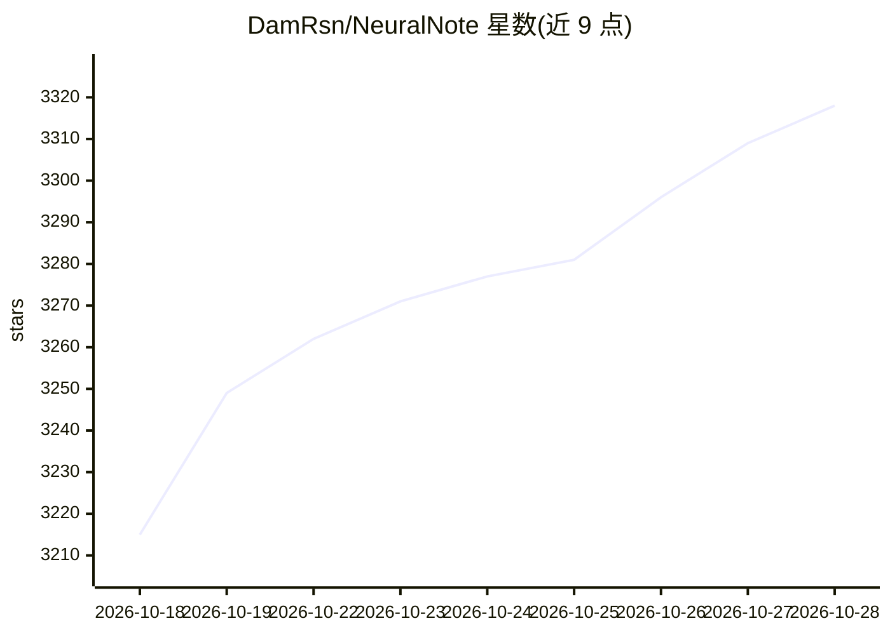

# DamRsn/NeuralNote

⭐ 3,318 · C++ · Apache-2.0 · 推送 2026-10-23 · [GitHub](https://github.com/DamRsn/NeuralNote) · [官网](https://neuralnote.co/) · 个人维护

**音频转 MIDI 转录插件：在 DAW 内本地转录多乐器音符**

面向音乐制作人的 VST3/AU/Standalone 音频插件，使用 MuScriptor transformer 模型（103M–1.4B 参数）把录音或音频文件转录为 MIDI，支持多乐器转录、按乐器分组的内置合成器回放。转录完全在本地 GPU（Metal/Vulkan）或 CPU 运行，音频不出本机；模型以 GGUF 格式首次使用时下载（210MB–2.7GB）。macOS/Windows 提供签名安装包，Linux 需自行编译。转录引擎 muscriptor.cpp 为独立可复用库。

## 筛选速览

| 维度 | 判定 | 备注 |
|---|---|---|
| AI 角色 | `ai-native` | 本体是模型或模型工具 |
| 许可风险 | `permissive` | Apache-2.0 |
| 部署形态 | `desktop` | 安装包/桌面程序 |
| 模型依赖 | — | README 未给出锁定关系 |
| 硬件要求 | `cpu-ok` | |
| 安装摩擦 | `medium` | 含编译或系统依赖之一 |
| 成熟度 | `idea` | |

## 能力要点

- MuScriptor 多乐器转录，音符按乐器分组
- 完全本地运行（Metal/Vulkan GPU 或 CPU），音频不出本机
- 内置多乐器合成器，可逐乐器调音量/静音/独奏
- 转录引擎 muscriptor.cpp（C++/ggml）作为独立库可复用

## 适用场景

- 在 DAW 里把录音或音频文件转成 MIDI 音轨
- 从完整混音中分离提取多种乐器的音符
- 本地离线完成转录，不把音频上传到任何服务

## 场景标签

 · 领域:音频/音乐制作工具

## 证据(README 行号)

> L3: NeuralNote is the audio plugin that brings **state-of-the-art audio-to-MIDI transcription** into your favorite Digit
> L14: - **A new, much more capable transcription model.** v2 replaces Spotify's Basic Pitch with
> L24: - **Still fully local.** Transcription runs on your machine, on the GPU or the CPU, and your audio never leaves it.

## 星数曲线

2026-10-18 3,215 → 2026-10-28 3,318（+103）

---
*卡片 v1 · prompt 1.4 · 生成 2026-10-20 · 置信度 high · 依据 README sha `259acfe5abfe` · [字段定义](../../DATASET.md)*
