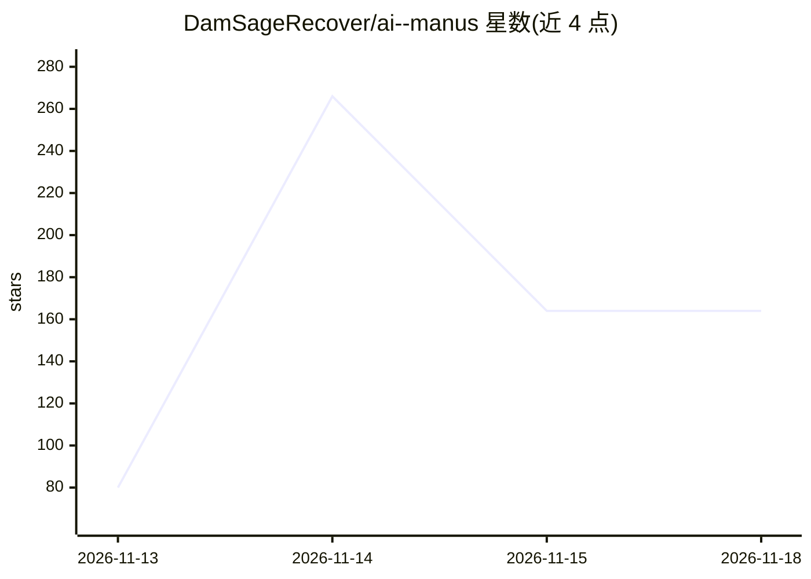

# DamSageRecover/ai--manus

⭐ 164 · Apache-2.0 · 推送 2026-11-15 · [GitHub](https://github.com/DamSageRecover/ai--manus) · 个人维护

**宣称可自主执行代码与控制浏览器的通用 AI Agent**

README 将 Manus 描述为一个自主 AI 代理，声称能代表用户编写并执行脚本、控制浏览器（导航网页、填写表单、多步任务），定位为面向家庭、学习与轻量办公的个人助手，而非企业平台。文中给出兼容性表（最低 4GB 内存、双核 CPU）与六步上手说明（准备、配置、测试、精炼、应用、维护）。限制：README 未提供任何安装命令、下载链接实体或技术实现细节，功能描述均为宣传性文字，无法验证其运行机制。

## 筛选速览

| 维度 | 判定 | 备注 |
|---|---|---|
| AI 角色 | `ai-native` | 本体是模型或模型工具 |
| 许可风险 | `permissive` | Apache-2.0 |
| 部署形态 | `None` |  |
| 模型依赖 | — | README 未给出锁定关系 |
| 硬件要求 | — | 无带数字的原话,不猜 |
| 安装摩擦 | `low` | 无编译、无系统依赖或容器化 |
| 成熟度 | — | 结构信号不足 |

## 能力要点

- 声称支持自主代码执行与浏览器控制（导航、填表、多步任务）
- 声称代码任务与浏览器任务可在同一流程中衔接
- 给出最低配置要求（4GB 内存、双核 CPU、64 位系统）
- 定位为家庭/学习/轻量工作的个人助手

## 适用场景

- 让代理代为执行重复性的小脚本与网页操作
- 多页网页信息收集与摘要准备
- 学习与研究中的资料整理与快速计算

## 场景标签

`AI 助手` `浏览器自动化` `编码 Agent` · 领域:效率与自动化

## 证据(README 行号)

> L10: - **Autonomous Code Execution:** Manus AI agent runs code on its own to complete tasks, so you can focus on decisio
> L18: Manus is an autonomous AI agent designed to run code and control a browser on your behalf. Instead of acting like a

## 星数曲线

2026-11-13 80 → 2026-11-18 164（+84）

---
*卡片 v1 · prompt 1.4 · 生成 2026-11-17 · 置信度 low · 依据 README sha `0f78ee3a5dd2` · [字段定义](../../DATASET.md)*
