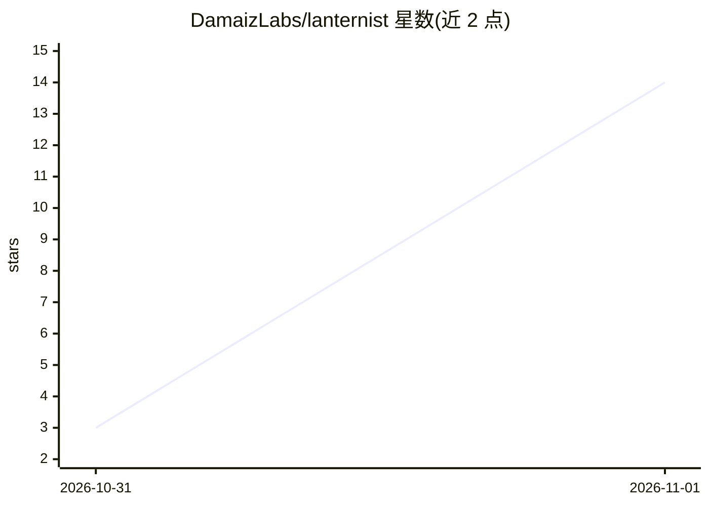

# DamaizLabs/lanternist

⭐ 14 · Python · MIT · 推送 2026-10-29 · [GitHub](https://github.com/DamaizLabs/lanternist) · [官网](https://www.damaizlabs.com/portfolio/automatizar-videos-con-ia/) · 组织维护

**在本地 GPU 上制作无真人出镜 YouTube 视频的生产引擎**

由 DamaizLabs 开源的 Nichebend Studio 生产引擎：用户给出选题，Claude Code 以技能（.claude/skills/）协作撰写脚本并生成场景 Python 文件，Lanternist 在本机显卡上用 ComfyUI+Qwen-Image 生成插图、Kokoro/Orpheus（llama.cpp）配音、ACE-Step 配乐并渲染 1080p 视频。每个产物写入 assets.json 记录来源与许可，视频带 C2PA 签名与不可见水印，默认不自动上传。仅支持 Windows 11 + NVIDIA CUDA（≥8GB VRAM），需高用量 Claude 订阅；目前提供一种格式（láminas）。

## 筛选速览

| 维度 | 判定 | 备注 |
|---|---|---|
| AI 角色 | `ai-native` | 本体是模型或模型工具 |
| 许可风险 | `permissive` | MIT |
| 部署形态 | `library` | 以包/库形式分发 |
| 模型依赖 | — | README 未给出锁定关系 |
| 硬件要求 | — | 无带数字的原话,不猜 |
| 安装摩擦 | `medium` | 含编译或系统依赖之一 |
| 成熟度 | `idea` | |

## 能力要点

- Claude Code 技能驱动：从选题到周更视频的端到端流水线
- 图像/语音/音乐/渲染全部在本机 GPU 完成，产物默认留在本机
- 每次运行生成 assets.json 记录每件素材的来源、许可与 URL
- 视频与缩略图自带 C2PA 签名元数据与不可见水印（C2PA/TrustMark），并提供本地检测器

## 适用场景

- 我想在自家电脑上批量产出无真人出镜的 YouTube 频道视频
- 我希望每期脚本、画面在花 GPU 时间前由我逐项确认
- 我需要视频自带 AI 生成标识与素材溯源记录以符合披露要求

## 场景标签

`图像生成` `语音合成` `视频生成` · 领域:内容生成

## 证据(README 行号)

> L5: You bring a topic and your YouTube channel. Claude Code writes each script with you and turns it into a scene, and
> L20: - **Images**: Qwen-Image, running in ComfyUI on your PC.
> L129: Every video and thumbnail that Lanternist makes carries **two machine-readable marks** that say it was made with A

## 星数曲线

2026-10-31 3 → 2026-11-01 14（+11）

---
*卡片 v1 · prompt 1.4 · 生成 2026-10-31 · 置信度 mid · 依据 README sha `039e76527de2` · [字段定义](../../DATASET.md)*
