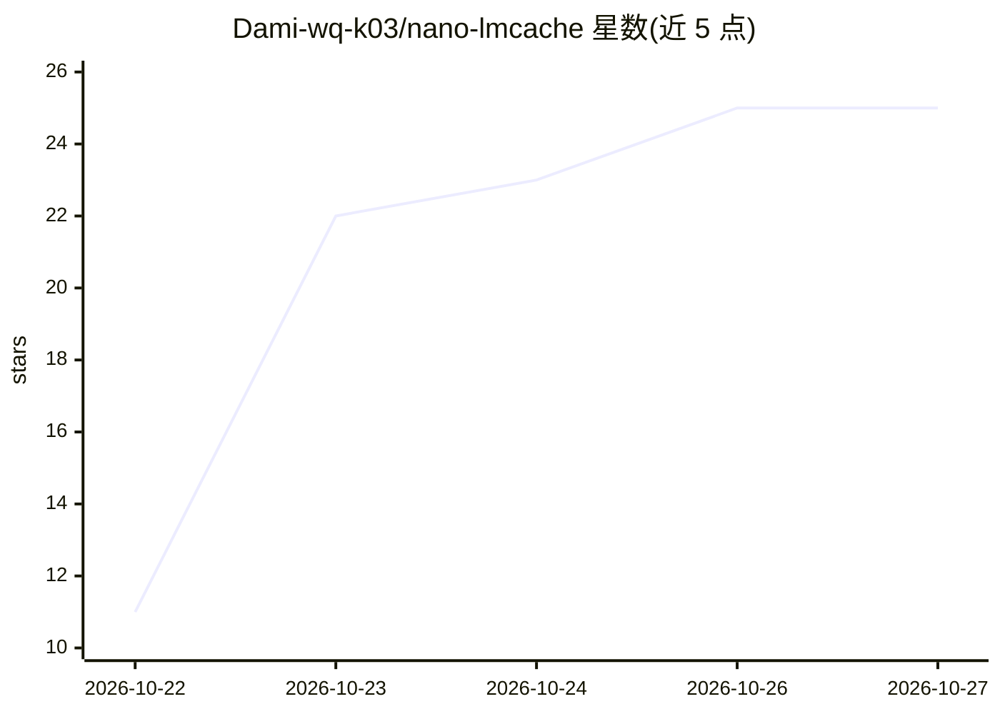

# Dami-wq-k03/nano-lmcache

⭐ 25 · Python · MIT · 推送 2026-10-23 · [GitHub](https://github.com/Dami-wq-k03/nano-lmcache) · 个人维护 · 中文 README

**教学项目：逐步实现 LLM KV cache 复用并接入 nano-vLLM**

面向学习者的 KV cache 复用教学实现：从纯 Python 原型出发，逐步构建前缀匹配、chunk key、内存/磁盘/分层存储与淘汰机制，每个概念配测试与可运行示例（含命中/未命中指标与缓存检查工具）。支持加载真实模型（如 Qwen3-0.6B）演示 KV 卸载到 CPU RAM/磁盘，并可作为 nano-vLLM 推理引擎的外部 KV cache（需 Linux+NVIDIA GPU）。项目自述为教学用途、非 LMCache 的替代实现，优先清晰性与可测试性而非生产性能。

## 筛选速览

| 维度 | 判定 | 备注 |
|---|---|---|
| AI 角色 | `ai-knowledge` | 知识聚合/清单类 |
| 许可风险 | `permissive` | MIT |
| 部署形态 | `None` |  |
| 模型依赖 | — | README 未给出锁定关系 |
| 硬件要求 | — | 无带数字的原话,不猜 |
| 安装摩擦 | `medium` | 含编译或系统依赖之一 |
| 成熟度 | — | 结构信号不足 |

## 能力要点

- 从纯 Python 原型到 GPU tensor 的分步教学实现
- 前缀缓存、chunk key、分层存储与磁盘缓存示例
- 可充当 nano-vLLM 推理引擎的外部 KV cache
- 提供缓存检查工具（nano_lmcache.inspect，支持 JSON 输出）

## 适用场景

- 系统学习 LLM KV cache 复用与缓存设计概念
- 阅读 LMCache/vLLM 等生产系统前的入门实践
- 在 nano-vLLM 上体验外部 KV cache 复用

## 场景标签

 · 领域:LLM 推理基础设施/教学

## 证据(README 行号)

> L7: An educational, step-by-step implementation of KV cache reuse, from a
> L11: nano-lmcache is a teaching project, not a reimplementation or replacement
> L19: - Understand KV cache reuse and prefix matching.

## 星数曲线

2026-10-22 11 → 2026-10-27 25（+14）

---
*卡片 v1 · prompt 1.4 · 生成 2026-10-27 · 置信度 high · 依据 README sha `b04f2e8c3dee` · [字段定义](../../DATASET.md)*
