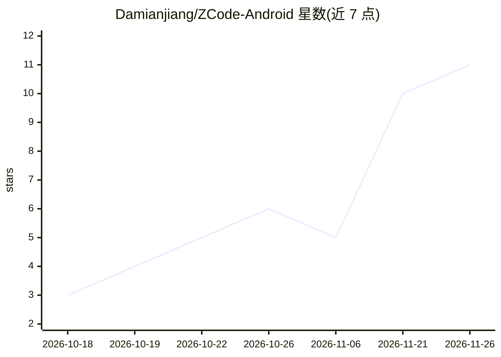

# Damianjiang/ZCode-Android

⭐ 11 · Kotlin · 推送 2026-10-03 · [GitHub](https://github.com/Damianjiang/ZCode-Android) · [官网](https://damianjiang.github.io/ZCode-Android/) · 个人维护 · 中文 README

**非官方 Android 客户端：手机远程查看和操控桌面 ZCode 会话**

通过逆向 ZCode 官方 Web 远程控制页面的通信协议实现的 Android 客户端，使用 Kotlin + Jetpack Compose（Material 3）与 OkHttp 编写，不依赖浏览器。功能覆盖设备配对（扫码/URL）、工作区与会话浏览、流式对话渲染、工具调用执行卡片、附件分片上传、消息排队、权限审批、任务面板与调试日志。协议栈含 wss 长连接、HMAC-SHA256 配对、varint IPC 与分片重传。需 JDK 17 与 Android SDK 35 从源码构建，仅支持 Android 12+ arm64。

## 筛选速览

| 维度 | 判定 | 备注 |
|---|---|---|
| AI 角色 | `ai-enhanced` | 去掉 AI 部分产品仍成立 |
| 许可风险 | `none` | — |
| 部署形态 | `None` |  |
| 模型依赖 | — | README 未给出锁定关系 |
| 硬件要求 | — | 无带数字的原话,不猜 |
| 安装摩擦 | `medium` | 含编译或系统依赖之一 |
| 成熟度 | `idea` | |

## 能力要点

- 逆向 Web 协议独立实现，含 wss 长连接、HMAC-SHA256 配对与断线重传
- 流式对话与工具调用执行卡片，支持子智能体只读查看
- 手机端权限审批与任务管理（审批文件/命令、终止运行中任务）
- 凭据用 Android Keystore（AES/GCM）加密仅存本地

## 适用场景

- 在手机上查看桌面 ZCode 的运行中/历史会话并继续对话
- 外出时在手机上审批文件修改或命令执行请求
- 多台桌面设备统一扫码配对、随时切换管理

## 场景标签

`编码 Agent` · 领域:编码与开发

## 证据(README 行号)

> L5: Android 端的 ZCode 远程控制客户端。通过逆向官方 Web 远程控制页面的通信协议实现，
> L6: 可以在手机上查看和操控桌面端 ZCode 的会话，不依赖浏览器。

## 星数曲线

2026-10-18 3 → 2026-11-26 11（+8）

---
*卡片 v1 · prompt 1.4 · 生成 2026-11-21 · 置信度 high · 依据 README sha `fa5845953c8e` · [字段定义](../../DATASET.md)*
