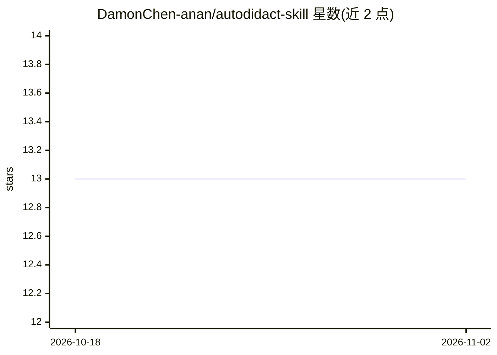

# DamonChen-anan/autodidact-skill

⭐ 13 · MIT · 推送 2026-04-13 · [GitHub](https://github.com/DamonChen-anan/autodidact-skill) · 个人维护 · 中文 README

**给研究者的 Claude Code 自主调研技能：自动检索网络并生成结构化 wiki**

基于 Karpathy's LLM Wiki 模式的 Claude Code 技能插件：用户给出一个主题，它自主驱动研究循环——生成问题、搜索网络抓取来源、把原始资料编译为持久互联的 wiki 文章、审计知识缺口并驱动下一轮迭代，直至满足停止条件（缺口递减、问题重叠度高等）。四个技能（autodidact/questioner/researcher/wiki）可独立使用，支持暂停恢复与用户插入问题。必需依赖 Claude Code，推荐安装 agent-browser 提升抓取质量，未安装时回退到内置 WebSearch。

## 筛选速览

| 维度 | 判定 | 备注 |
|---|---|---|
| AI 角色 | `ai-native` | 本体是模型或模型工具 |
| 许可风险 | `permissive` | MIT |
| 部署形态 | `library` | 以包/库形式分发 |
| 模型依赖 | locked-api |  |
| 硬件要求 | — | 无带数字的原话,不猜 |
| 安装摩擦 | `low` | 无编译、无系统依赖或容器化 |
| 成熟度 | — | 结构信号不足 |

## 能力要点

- 自主研究循环：提问→检索→编译 wiki→审计缺口→迭代
- 停止条件量化：缺口≤上轮60%、问题重叠>70% 等
- 四个技能可独立使用，支持暂停恢复与用户插入问题
- 研究中英双语检索，非英语主题可用

## 适用场景

- 给一个主题让它自动产出结构化的主题 wiki 与来源库
- 技术调研：自动检索、编译并补齐知识缺口
- 研究中途补充自己的问题引导调研方向

## 场景标签

`科研工具` · 领域:学习与行业

## 证据(README 行号)

> L12: **autodidact takes it one step further**: you don't even need to supply the sources. Give it a research topic, and 
> L54: - **Claude Code** — autodidact is a Claude Code skill plugin

## 星数曲线

2026-10-18 13 → 2026-11-02 13（+0）

---
*卡片 v1 · prompt 1.4 · 生成 2026-10-31 · 置信度 mid · 依据 README sha `f9979ea03fe9` · [字段定义](../../DATASET.md)*
