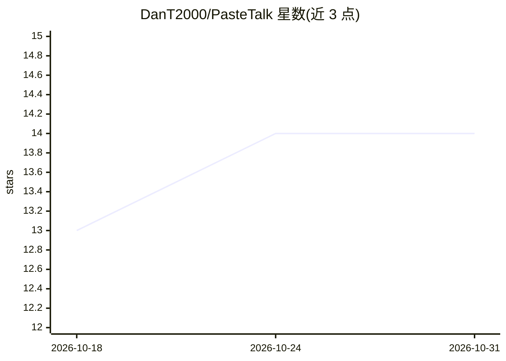

# DanT2000/PasteTalk

⭐ 14 · JavaScript · MIT · 推送 2026-10-30 · [GitHub](https://github.com/DanT2000/PasteTalk) · [官网](https://github.com/DanT2000/PasteTalk/releases/latest) · 个人维护 · 中文 README

**Windows 按键语音转文字工具：本地 Whisper，不出网**

面向 Windows 用户的按键式语音听写桌面应用：按下热键说话，faster-whisper 在本机 GPU（CUDA）或 CPU 上识别，文本进入剪贴板。提供 5 种 Whisper 模型选择、音视频文件转录（FFmpeg 可选）、经 LM Studio/Ollama/Claude Code/Codex/ChatGPT/DeepSeek 或自建 /v1/chat/completions 服务器做可选的文本润色（默认关闭）。另含 Android 应用与 Telegram 机器人，经自建服务器（Docker 部署）路由到本人电脑或云端识别。MIT 许可，作者 DanT2000，安装包需自行通过 SmartScreen 提示。

## 筛选速览

| 维度 | 判定 | 备注 |
|---|---|---|
| AI 角色 | `ai-native` | 本体是模型或模型工具 |
| 许可风险 | `permissive` | MIT |
| 部署形态 | `desktop` | 安装包/桌面程序 |
| 模型依赖 | local-ok | 支持本地模型 |
| 硬件要求 | — | 无带数字的原话,不猜 |
| 安装摩擦 | `medium` | 含编译或系统依赖之一 |
| 成熟度 | — | 结构信号不足 |

## 能力要点

- faster-whisper 本地识别，音频与文本不出机器，支持 CUDA/CPU
- 分段流式识别：说完一句即送模型，不等整段结束
- 音视频文件转录（MP4/MKV/MP3/WAV 等，FFmpeg 可选）
- Android 应用与 Telegram 机器人经自建服务器接入

## 适用场景

- 写作、回复消息时按键听写代替打字
- 离线、注重隐私环境下做语音转文字
- 转录视频或音频文件为带时间戳文本
- 出门在外用手机经自家服务器完成听写

## 场景标签

`语音识别` · 领域:感知与多模态

## 证据(README 行号)

> L7: **Голос в текст по горячей клавише. Локально, без интернета.**
> L107: - **Распознавание на своём железе** — faster-whisper на видеокарте (CUDA) или процессоре. Пять моделей от Tiny до 

## 星数曲线

2026-10-18 13 → 2026-10-31 14（+1）

---
*卡片 v1 · prompt 1.4 · 生成 2026-10-31 · 置信度 high · 依据 README sha `f244bc6cfedb` · [字段定义](../../DATASET.md)*
