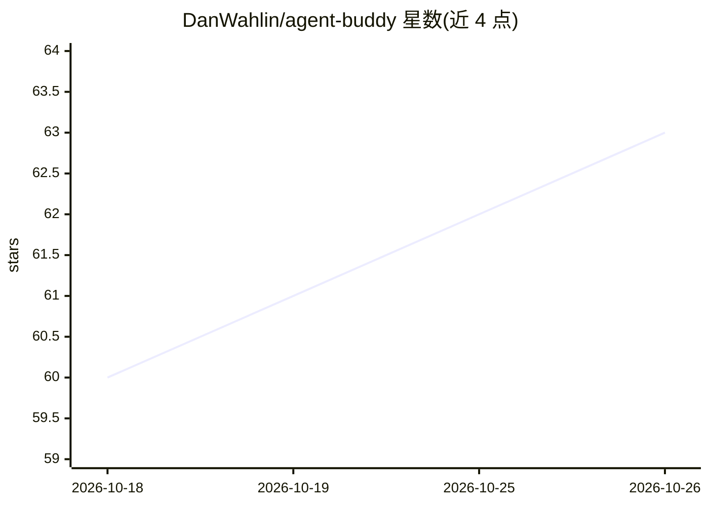

# DanWahlin/agent-buddy

⭐ 63 · TypeScript · MIT · 推送 2026-10-22 · [GitHub](https://github.com/DanWahlin/agent-buddy) · [官网](https://danwahlin.github.io/agent-buddy/) · 个人维护

**在 ESP32 设备或桌面上显示 AI 编程助手状态的桌面伴侣**

运行在 Waveshare ESP32-S3 触控屏或桌面透明窗口上的动画角色，通过各编程 agent（GitHub Copilot、Claude Code、Codex CLI、Grok Build、Hermes Agent、OpenClaw）的 lifecycle hooks 报告事件，以 Working、Needs attention、Complete 等动画与 agent 徽章显示其状态，并在屏幕底部显示 Copilot AI credits 与 token 用量。后台 companion daemon 汇合多个 agent 事件并经 USB 或本地 Wi-Fi 发送到设备；全部本地运行，无云服务。支持换装角色包、本地设置页与可选声音提示。桌面应用提供 macOS/Windows/Linux 安装包，也可用 flash.py 与 npm 从源码运行。

## 筛选速览

| 维度 | 判定 | 备注 |
|---|---|---|
| AI 角色 | `ai-ecosystem` | LLM/agent 周边工具 |
| 许可风险 | `permissive` | MIT |
| 部署形态 | `desktop` | 安装包/桌面程序 |
| 模型依赖 | — | README 未给出锁定关系 |
| 硬件要求 | — | 无带数字的原话,不猜 |
| 安装摩擦 | `low` | 无编译、无系统依赖或容器化 |
| 成熟度 | — | 结构信号不足 |

## 能力要点

- 6 种编程 agent 的生命周期 hooks 驱动角色状态与徽章
- 固件+角色包经 USB 或本地 Wi-Fi 推送到 Waveshare ESP32-S3 触控屏
- 桌面应用以透明窗口显示同一角色，无需额外依赖
- 显示 Copilot AI credits（AIC）与 agent token 用量

## 适用场景

- 在桌面小屏上实时看到编程 agent 是否在干活或等我确认
- 同时用多个 coding agent 时跟踪各自状态
- 不接设备时在桌面窗口显示同样的角色动画

## 场景标签

 · 领域:开发者工具/嵌入式硬件

## 证据(README 行号)

> L30: - **Agent-aware states:** Working, Needs attention, and Complete animations driven
> L56:     A["AI agents Copilot, Claude, Codex, Grok, Hermes, OpenClaw"] -- lifecycle hooks --> D["Companion daemo
> L65: 3. **The companion daemon** runs in the background on your computer. It combines

## 星数曲线

2026-10-18 60 → 2026-10-26 63（+3）

---
*卡片 v1 · prompt 1.4 · 生成 2026-10-24 · 置信度 mid · 依据 README sha `1d3e67641d19` · [字段定义](../../DATASET.md)*
