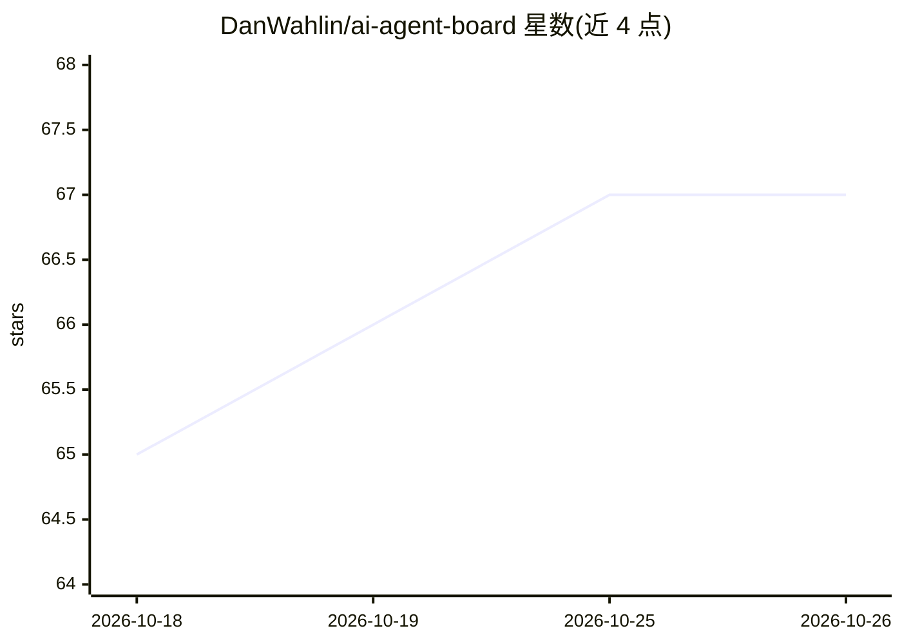

# DanWahlin/ai-agent-board

⭐ 67 · TypeScript · MIT · 推送 2026-09-19 · [GitHub](https://github.com/DanWahlin/ai-agent-board) · 个人维护

**拖拽式看板，将编码任务分派给多种 AI coding agent 执行**

基于 React/Express 的自托管 Kanban 应用：创建任务卡片，拖入 In Progress 后选择一个已安装的 agent CLI（GitHub Copilot、Claude Code、OpenAI Codex、OpenCode、Hermes、OpenClaw），由 agent 规划并执行编码工作，事件经 WebSocket 实时流式回看板。支持每任务 git worktree 隔离、本地合并或创建 PR、2-20 个子任务的任务组与并行度调节、SQLite 或 PostgreSQL 双后端、API key 认证与编排 API 集成。启动时自动检测本机已装的 agent CLI，需 Node.js 22+ 与至少一个已认证 agent，运行于 Linux/macOS/Windows。

## 筛选速览

| 维度 | 判定 | 备注 |
|---|---|---|
| AI 角色 | `ai-ecosystem` | LLM/agent 周边工具 |
| 许可风险 | `permissive` | MIT |
| 部署形态 | `self-host` | docker 或自建部署 |
| 模型依赖 | — | README 未给出锁定关系 |
| 硬件要求 | — | 无带数字的原话,不猜 |
| 安装摩擦 | `low` | 无编译、无系统依赖或容器化 |
| 成熟度 | — | 结构信号不足 |

## 能力要点

- 6 种 agent CLI（Copilot/Claude Code/Codex/OpenCode/Hermes/OpenClaw）经统一 AgentEvent 事件格式接入
- 每任务可选 git worktree 隔离，完成后本地合并或创建 PR
- 任务组支持 2-20 个子任务与 1..N 并行度滑块
- SQLite 零配置默认或 PostgreSQL 双数据库后端

## 适用场景

- 在可视化看板上并行调度多个 AI agent 处理编码任务
- 用任务组批量发起相关变更并跟踪聚合进度
- 通过编排 API 从外部系统创建并跟踪 agent 任务

## 场景标签

`编码 Agent` · 领域:编码与开发

## 证据(README 行号)

> L30: The server uses a **provider pattern** (via `@codewithdan/agent-sdk-core`) to support multiple AI coding agents beh
> L36: Each task can specify which agent to use. Available agents are auto-detected at startup by checking for installed C

## 星数曲线

2026-10-18 65 → 2026-10-26 67（+2）

---
*卡片 v1 · prompt 1.4 · 生成 2026-10-24 · 置信度 mid · 依据 README sha `8c725db499e1` · [字段定义](../../DATASET.md)*
